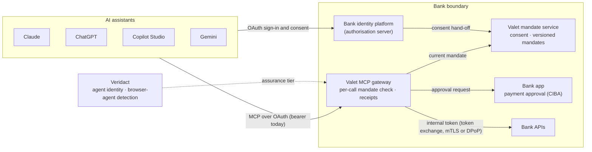

# Veridact Valet: MCP Gateway & AI Assistant Connectors – Design

Draft v0.2 · 9 November 2026 · Not yet built: this is the design for Valet's next feature.

## Summary

Valet's next feature is a bank-run MCP gateway: the front door that lets Claude and ChatGPT reach a customer's account under a written mandate, without passwords and without screen-scraping. Microsoft Copilot (via Copilot Studio) and Gemini (Enterprise and the consumer app) follow on the same gateway, with per-platform client registration only.

Key decisions:

- **Bank-deployed, not hosted.** Each bank runs the gateway inside its own boundary, on its existing identity platform. No aggregator, no Valet-held bank tokens.
- **One policy decision per call.** The bank issues both account access and the agent mandate, so the gateway enforces a single intersection, not two separate grants.
- **Bearer tokens are accepted, but made boring to steal.** Claude and ChatGPT cannot send DPoP today. Short-lived, audience-bound tokens, confidential clients and in-app payment approval cap what a stolen token can do.
- **Mandate ceilings follow token assurance.** Bearer clients get read-only plus approve-every-payment; DPoP-bound or Veridact-verified agents can earn higher limits.
- **Small pilot surface.** Four read tools and one capped payment tool to existing payees. No beneficiary management in v1.

The gateway is how agents connect. The product is still mandates, enforcement and evidence.

## Problem and context

Agents are already in customers' bank accounts, mostly by climbing in through the window. The agents with real traffic (Perplexity Comet, ChatGPT Atlas, Claude for Chrome, ChatGPT Agent) are browser agents. They don't need a password because they ride the customer's logged-in session, which is worse than password sharing.

Where agents do connect properly, the pattern is an OAuth-protected MCP connector. Today those connectors are run by fintech middlemen (Meow, Copilot Money, BankBridge) or sit on aggregators such as Plaid. That model has three problems for Valet:

- **The middleman becomes a honeypot.** An aggregator gateway holds upstream bank tokens for every customer.
- **The evidence sits with the wrong party.** A bank can't settle a dispute from a record an intermediary keeps.
- **It doesn't fit South Africa.** There is no mandated open banking regime yet (to be confirmed), so the bank's own APIs are the realistic route.

Valet's answer is a front door the bank owns. Bans won't move agents off screen-scraping; a front door that is easier than the browser will.

## Design principles applied to the gateway

Each of Valet's five principles maps to a concrete gateway behaviour.

| Valet principle | Gateway behaviour |
| --- | --- |
| Never collect passwords | The gateway is an OAuth resource server; the bank's identity platform issues the agent its own token. No password, PIN or OTP ever reaches the agent. |
| Write the authority down first | Valet's consent screen, reached during the OAuth flow, builds the mandate: payees, amount, frequency, expiry, in plain language. The tool list is filtered by mandate, so a tool the agent may not use is never shown. |
| Keep the rules outside the model | Every tool call is checked against the mandate at the gateway. Tool descriptions are hints to the model, never controls. |
| The agent is never its own witness | The gateway signs a tamper-evident receipt per call, including the agent-supplied triggering instruction, labelled as such. |
| The bank stays in charge | The gateway runs inside each bank's boundary, on its existing identity platform. Valet never holds bank tokens. |

## Architecture

The gateway sits inside the bank's boundary, between every assistant and the bank's APIs, with the bank's identity platform and app beside it.

Assistants connect over OAuth; the identity platform hands consent to Valet's mandate service, and the gateway checks each call against the current mandate, sends payments to the bank app for approval, calls the bank's APIs with an internal token, and writes a signed receipt. Veridact sits alongside: it verifies agent identity to raise the assurance tier, and detects browser agents that skip the gateway and ride web sessions.

## Authorisation and token model

One gateway serves every assistant, because Claude, ChatGPT, Copilot Studio and Gemini all follow the MCP authorization spec: the gateway is an OAuth protected resource, and the bank's identity platform (PingFederate in the reference build) is the authorization server.

1. The assistant calls the gateway and gets a 401 pointing to its protected resource metadata.
2. The assistant reads the authorization server metadata from PingFederate and identifies itself with a pre-registered client ID (see token protection).
3. The customer signs in with the bank's normal MFA and the IdP hands them to Valet's consent screen, where they build the mandate (see Consent and delegation).
4. PingFederate issues a short-lived access token carrying only the mandate ID, audience-bound to the gateway's resource URI, plus a rotating refresh token.
5. On each tool call, the gateway validates the token, fetches the current mandate version from Valet's mandate service, and evaluates it against the call's parameters.
6. The gateway exchanges the inbound token for an internal token (RFC 8693 token exchange) bound with mTLS or DPoP, and calls the bank's APIs. The inbound token is never passed through, which the MCP spec forbids.
7. The gateway signs a receipt and returns only the permitted data.

**One grant, not two.** Aggregator designs enforce two grants: bank consent to the app, then app delegation to the agent. In Valet the bank issues both, so the effective permission is one policy decision at one enforcement point. That is simpler to build and easier for a customer to understand.

## Consent and delegation

The customer, not the agent, decides what the agent can do: the mandate is built on the bank's own consent screen, and the agent's scope request is only a ceiling. Claude and ChatGPT ask for generic scopes, so the real choices have to be made on the bank's side.

**Who delegates to whom.** The customer is the principal. The agent is the delegate. The assistant platform (Anthropic, OpenAI, Microsoft, Google) is the OAuth client that carries the delegation. The bank is the enforcer and the witness.

### What the customer decides

| Decision | Options | Default |
| --- | --- | --- |
| Which accounts | Tick each account the agent can see | None ticked |
| What it can do, per account | See balance; see transactions (with look-back window); see payees; request payments | See balance only |
| Which payees | Pick from existing payees only; no new beneficiaries | None |
| Payment limits | Per-payment cap; monthly total; payments per month | Payments off |
| Approval mode | Approved payer (the customer approves every payment in the bank app); bill payer (pays named payees within the caps without asking; offered only above the bearer tier) | Approved payer |
| Data shown | Account numbers masked; counterparty names on or off | Masked |
| Expiry | 7, 30 or 90 days | 30 days |

Defaults are least privilege: a customer who clicks straight through grants one account's balance for 30 days and nothing else. Options above the client's assurance tier are shown but disabled, with a one-line reason, so customers learn why a stronger agent can do more.

**Presets** speed up the common cases without hiding the detail: "Budget helper" (read-only, 90 days of transactions), and "Bill helper" (named payees, caps, approve every payment). The customer can adjust any preset before confirming.

**Plain-language summary.** Before confirming, the customer reads one sentence that states the whole mandate, for example: "Claude can see your Cheque account balance and the last 90 days of transactions, and can ask to pay City of Cape Town and Vodacom up to R2,000 each, at most 4 payments a month. You approve every payment in the app. Access ends on 28 November 2026." If the customer can't answer "what can my agent do with my money?" from that sentence, the screen has failed.

**Confirmation.** The customer confirms with the bank's normal step-up (app approval or MFA).

### Where the mandate lives: Valet, not the IdP

Valet owns the mandate; the identity platform only authenticates the customer and issues tokens. This keeps Valet IdP-agnostic, so the same product works for banks on PingFederate, Entra, Keycloak or ForgeRock, and keeps the mandate lifecycle as Valet's value rather than a vendor configuration.

| Concern | Owned by |
| --- | --- |
| Who the customer is (sign-in, MFA, step-up) | Bank IdP |
| Issuing and refreshing tokens | Bank IdP |
| Consent screen, presets and plain-language summary | Valet mandate service |
| Structured, versioned mandate record | Valet mandate service |
| Narrowing, widening, pause and revoke | Valet mandate service, via the Agent access page |
| Enforcing the mandate per call | Valet gateway |
| Receipts linked to mandate ID and version | Valet gateway |

**How the hand-off works.** During the OAuth authorization step, the IdP authenticates the customer, then hands off to Valet's consent app. Valet records the mandate and returns a mandate ID, which the IdP adds to the token as a claim. The token carries only that ID, never the mandate's contents.

**Why the gateway looks the mandate up on every call.** Because the token is only a pointer, a narrowed or revoked mandate takes effect on the next call, with no need to wait for the token to expire.

**Standards path.** The mandate model maps onto OAuth Rich Authorization Requests (RFC 9396) `authorization_details`, so Valet can expose it in that format to IdPs and clients that support it, without depending on them. It uses the Technical Design's types (valet_accounts, valet_payments, valet_payment_once), so a mandate and a grant are one record.

**What this makes Valet responsible for.** The mandate service becomes the system of record for customer consent. It runs inside the bank's boundary like the gateway, and needs high availability, POPIA-grade data handling, and an immutable history of every mandate version.

The consent screen reads top to bottom as the mandate: accounts, capabilities, payees, limits, approval and expiry, ending in the one-sentence summary the customer confirms with step-up.

### After the grant: changing and revoking

The bank app and online banking get an **Agent access** page listing each connected agent, its mandate summary, last activity and receipts.

- **Narrowing is instant.** Removing an account, payee or capability takes effect on the agent's next call. The gateway re-filters the tool list and tells the client the list changed.
- **Widening needs re-consent.** Adding accounts, payees or higher limits sends the customer back through the consent screen with step-up. The agent can't widen its own mandate.
- **Pause and revoke.** Each agent can be paused or revoked, and one switch revokes every agent.
- **One mandate per agent.** Claude and ChatGPT connected to the same account hold separate mandates and separate receipts.
- **Notifications.** The customer gets a push when a mandate is created or changed, and a reminder a few days before expiry.

### Business banking

For Copilot and Gemini Enterprise, a company administrator grants the mandate on company accounts. The mandate can never exceed the administrator's own entitlements, and payment mandates follow the bank's existing dual-control rules: a second authoriser approves the mandate, and payments still need approval per the company's mandate rules.

### Open points

- [ ] Joint accounts: does one holder's consent suffice, or do both need to agree?
- [ ] Confirm each target IdP's hook for handing off consent to an external app and adding the mandate ID as a token claim (PingFederate first).
- [ ] Decide the maximum expiry the bank will allow for payment mandates.

## Token protection without client DPoP

Claude and ChatGPT present plain bearer tokens today, so Valet makes those tokens worth little on their own. DPoP for MCP exists only as an optional extension, SEP-1932, and Claude Code [does not yet send DPoP proofs](https://github.com/anthropics/claude-code/issues/96290) even when the authorization server requires them.

The threat is narrower than it looks. These connectors hold the token in the platform's cloud, not on the customer's device. Even with DPoP the key would sit on the same platform, so DPoP mainly protects against leaks in transit and in logs. This bearer path does not meet FAPI 2.0, which requires sender-constrained tokens; say so plainly to bank security teams.

| Control | What it stops |
| --- | --- |
| Pre-registered confidential client per platform, per bank | A stolen refresh token is useless without the platform's client secret. Also gives a known, allowlisted agent identity. |
| Access tokens of about 5 minutes, audience-bound to the gateway's resource URI | Replay elsewhere and long-lived misuse. |
| Opaque or phantom tokens | A leaked token reveals no customer data. |
| Refresh token rotation with reuse detection | A replayed old refresh token revokes the whole token family. |
| Platform egress IP allowlist | Tokens issued to the Claude or ChatGPT client only work from that platform's published ranges (defence in depth only: the ranges change and the bank must track them). |
| Mandate caps plus in-app payment approval | A thief can at most request a capped payment to an existing payee, which the customer must approve. |
| Sender-constrained internal leg (mTLS or DPoP) | The token behind the gateway can't be replayed against bank APIs. |
| Revocation checked on every call | A revoke in the bank app fails the agent's very next call. |

### Assurance-tiered mandates

The gateway accepts DPoP now and requires it from clients that support it. The mandate ceiling then follows token assurance:

| Client assurance | Example clients | Mandate ceiling |
| --- | --- | --- |
| Bearer, platform client | Claude, ChatGPT, Copilot Studio, Gemini today | View only, or Approved payer (every payment approved in the bank app) |
| DPoP-bound | Clients once SEP-1932 ships; bank's own agents | Bill payer, within lower caps the bank sets |
| DPoP-bound and Veridact-verified | Agents with a verified Veridact identity | Bill payer, with the bank's full caps |

This turns the DPoP gap into a sellable rule: the stronger the agent proves itself, the more it can do. For Claude and ChatGPT, though, the OAuth client is the platform, not the individual agent, so Veridact cannot raise their tier yet: retail customers on those platforms stay on the bearer tier until the platforms send DPoP and carry an agent-level identity.

## Tool surface for the pilot

The pilot exposes five tools: four reads and one capped payment, the demo nobody else has. Read-only alone would put Valet next to Copilot Money and BankBridge.

| Tool | Type | Mandate check | Approval |
| --- | --- | --- | --- |
| `bank.list_accounts` | Read | Accounts in the mandate only | None |
| `bank.get_balance` | Read | Account in the mandate | None |
| `bank.list_transactions` | Read | Account and look-back window in the mandate; account numbers masked | None |
| `bank.list_payees` | Read | Payees named in the mandate only | None |
| `bank.pay_existing_payee` | Write | Payee in the mandate; under per-payment cap, monthly limit and payment count | Customer approves in the bank app, every time |

Out of scope for v1: adding or editing beneficiaries, transfers between accounts, card controls, and profile changes. Adding a beneficiary is the step attackers want most.

**Tool metadata.** Every tool carries MCP annotations (`readOnlyHint`, `destructiveHint`) and, for ChatGPT, a per-tool `securitySchemes` entry with its scopes. Input schemas avoid `$ref`, which Copilot Studio filters out.

**Payment approval flow.** `bank.pay_existing_payee` returns `pending` with a reference. The gateway triggers a back-channel approval (CIBA, supported by PingFederate) to the bank app. The customer sees payee, amount and the agent's stated reason, and approves or declines. The agent polls a small status helper, `bank.get_payment_status`. The receipt records both the agent's request and the customer's decision.

**Receipt contents.** Timestamp, mandate ID and version, agent client ID and assurance tier, tool and parameters, idempotency key, decision outcome with reason codes, risk score, triggering instruction (agent-supplied, labelled), approval outcome, and the gateway's signature.

### Decision contract and gateway requirements

Every money-moving call returns exactly one of three outcomes, and the gateway must guarantee the mandate's limits hold even under concurrent calls.

| Outcome | Meaning | Agent must |
| --- | --- | --- |
| `APPROVED` | Every hard rule and review rule passed | Proceed |
| `APPROVAL_REQUIRED` | Within the mandate, but needs the customer (per-payment approval, or escalated by risk) | Wait; poll the status helper |
| `DECLINED` | A hard rule failed (payee not in mandate, cap exceeded, mandate paused, expired or revoked) | Stop |

Each outcome carries machine-readable reason codes, such as `PAYEE_NOT_IN_MANDATE`, `PER_PAYMENT_CAP_EXCEEDED` or `MONTHLY_LIMIT_EXCEEDED`. The same codes go into the receipt, so the agent, the customer and the bank read one explanation. These outcomes are the MCP form of the core API's results ([Technical Design](technical-design.md) §10 and §14): APPROVED is a 200, APPROVAL_REQUIRED is approval_required, and DECLINED is any other 403. Reason codes are defined once, in the core profile.

**Requirements:**

1. **Risk can escalate, never override.** A separate risk score (amount anomaly, unusual timing, velocity, first payment to a payee by this agent) can turn `APPROVED` into `APPROVAL_REQUIRED`. It can never turn `DECLINED` into anything else, and it never replaces the mandate check. Policy and risk results are stored separately in the receipt.
2. **Serialised limit checks.** Checking the monthly limit, payment count and remaining budget, and reserving the amount, happen in one locked step per mandate. Two parallel payment calls can't both pass a cap that only one fits under. A reservation is released if the customer declines or the payment fails.
3. **Idempotency on every write.** `bank.pay_existing_payee` requires an idempotency key from the agent. A retried call with the same key returns the original outcome and never creates a second payment or approval request.
4. **Original decisions are immutable.** The customer's approve or decline is a new receipt linked to the original, never an edit to it.
5. **Same checks as the core API.** The gateway calls the same enforcement component as the direct API ([Technical Design](technical-design.md) §5), not a second policy engine, so each rule is written and tested once.

## Connector build: Claude

Claude uses the same connector infrastructure across Claude.ai, Desktop, mobile and Claude Code, so one build covers all of them. Source: [Authentication for connectors](https://claude.com/docs/connectors/building/authentication).

- **Transport.** Remote MCP server over Streamable HTTP, public HTTPS.
- **Discovery.** Protected resource metadata on the gateway, pointing to PingFederate's authorization server metadata.
- **Client identification.** Claude supports DCR, CIMD and Anthropic-held credentials. CIMD is only used when the server metadata advertises both `client_id_metadata_document_supported: true` and `none` in `token_endpoint_auth_methods_supported`. Valet uses a **pre-registered confidential client** instead: the custom connector's client secret field is optional, and the bank's server requires it.
- **Directory listing.** For directory connectors, Anthropic-held credentials give a stable registered client without DCR sprawl.
- **Refresh.** Rotate refresh tokens (Claude registers as a public client under DCR or CIMD; rotation applies regardless). Return `invalid_grant` when a refresh token is dead.
- **Redirect URI.** Allowlist Claude's callback in the PingFederate client.
- **Network.** Allowlist Claude's published egress ranges for this client.
- **Plans.** Custom connectors are on every plan; on Team and Enterprise only an Owner can add one.
- **Testing then review.** Test as a custom connector by URL, then submit to the Connectors Directory.

**Constraint to plan for:** Claude uses a single shared OAuth application per connector, with no tenant-level isolation. Each bank runs its own gateway and authorization server, so each bank is its own connector: customers add it by URL, or each bank goes through directory review separately.

## Connector build: ChatGPT

ChatGPT connects through the Apps SDK on the same MCP auth spec, so the gateway needs no ChatGPT-specific code, only a client registration and tool metadata. Source: [Apps SDK authentication](https://developers.openai.com/apps-sdk/build/auth).

- **Transport and discovery.** Same gateway URL and protected resource metadata as Claude.
- **Resource parameter.** ChatGPT sends the gateway's canonical HTTPS identifier as `resource` during OAuth; PingFederate must echo it and bind the token's audience to it.
- **Client identification.** ChatGPT supports CIMD, DCR and predefined OAuth clients, with PKCE. Valet uses a **predefined confidential client** per bank.
- **Token endpoint auth methods.** Publish only the methods the bank accepts (client secret for the predefined client).
- **Per-tool security.** Declare `securitySchemes` on each tool so ChatGPT knows which scopes each needs and can prompt for re-linking.
- **Token use.** ChatGPT exchanges the code for a token and sends it as `Authorization: Bearer` on each MCP request.
- **Redirect URI.** Allowlist ChatGPT's current callback in the PingFederate client.
- **Testing then review.** Build and test in ChatGPT developer mode, then submit for the app directory.

**Gap to note:** ChatGPT's browser-driving Agent Mode does not use custom apps, so the gateway only serves ChatGPT's connector path. Agents that drive the bank website still need detecting (see Veridact in the architecture).

## Microsoft Copilot and Gemini

Both can use the same gateway with no code changes, but they reach different customers: Copilot is a business-banking channel, while Gemini splits between enterprise and consumer.

### Microsoft Copilot

Copilot reaches MCP through agents an organisation builds, not through the consumer app. The free Copilot app reportedly can't add a custom MCP server; organisations use Copilot Studio or Microsoft 365 Copilot declarative agents instead.

- **Copilot Studio.** Add the gateway as an MCP tool on an agent, over Streamable HTTP only ([Microsoft Learn](https://learn.microsoft.com/en-za/microsoft-Copilot-studio/mcp-add-existing-server-to-agent)). OAuth 2.0 comes in three modes: dynamic discovery (DCR), dynamic, and manual with client ID and secret ([auth options](https://learn.microsoft.com/en-us/training/modules/integrate-agents-external-systems-mcp-copilot-studio/4-configure-mcp-authentication)). Valet uses **manual** mode with a confidential client. Power Platform data policies apply.
- **Microsoft 365 Copilot declarative agents.** Built with the Agents Toolkit, using OAuth with static registration and Microsoft's redirect URL ([Microsoft Learn](https://learn.microsoft.com/microsoft-365/copilot/extensibility/build-mcp-plugins)). The Entra SSO option doesn't apply, because the bank's identity platform is the authorization server.
- **Fit.** Copilot users are staff inside a company tenant. That makes it a **business and SME banking** channel: a finance team builds a Copilot agent that reads balances and queues supplier payments for approval.
- **Advantage.** Each customer organisation configures its own connection, so the bank can issue a client per business tenant. That is stronger agent identity than Claude's single shared client.

### Gemini

Gemini has three surfaces, all supporting remote MCP over OAuth.

- **Gemini Enterprise.** A custom MCP server connector, Streamable HTTP only, with an OAuth client ID and secret and Google's redirect URI. It is pre-GA and off by default ([Google support](https://support.google.com/g/answer/17106276)). Same fit as Copilot: business banking.
- **Consumer Gemini app.** Reportedly accepts a custom MCP server URL in Connected Apps on personal accounts, OAuth required ([Tallyfy](https://tallyfy.com/how-to-list-mcp-server-google-gemini/), third-party, to verify). If confirmed, this is a retail channel alongside Claude and ChatGPT.
- **Gemini CLI.** Supports MCP OAuth. Useful for developer testing, not a customer channel.

### Recommendation

1. **Phase 1:** Claude and ChatGPT for retail customers.
2. **Phase 2:** Copilot Studio and Gemini Enterprise for business banking, with a confidential client per business tenant.
3. **Watch:** the consumer Gemini app. Add it once its custom connector support is confirmed from Google's own documentation.

## Client compatibility matrix

All five target surfaces work with the same gateway; only client registration and redirect URIs differ.

| Surface | Customer segment | Transport | Client registration Valet uses | DPoP today | Phase |
| --- | --- | --- | --- | --- | --- |
| Claude (web, desktop, mobile, Code) | Retail | Streamable HTTP | Pre-registered confidential client; Anthropic-held for directory | No | 1 |
| ChatGPT (apps) | Retail | Streamable HTTP | Predefined confidential client | No | 1 |
| Copilot Studio / M365 declarative agents | Business, SME | Streamable HTTP | Manual OAuth, confidential client per tenant | No | 2 |
| Gemini Enterprise | Business, SME | Streamable HTTP | Client ID and secret | No | 2 |
| Gemini consumer app | Retail | Streamable HTTP | To confirm | No | Watch |

None of these surfaces documents DPoP support today, so every client starts on the bearer tier of the assurance-tiered mandates.

## Delivery plan

Delivery runs in four phases, and money only moves once counsel and the bank's security team have signed off.

| Phase | Scope | Gate to the next phase |
| --- | --- | --- |
| 1. Foundations | Gateway and IdP integration, four read tools, sandbox data, Claude and ChatGPT testing | Read-only demo works |
| 2. Payment tool | Capped payment, CIBA approval, signed receipts, mandate consent UI | Counsel and the bank's security team sign off |
| 3. Retail pilot | One bank with live users, connect by URL, directory reviews, assurance tiers on | Pilot review |
| 4. Business channels | Copilot Studio, Gemini Enterprise, a client per business tenant, DPoP tier when ready | |

Phase durations are open until a pilot bank and its PingFederate environment are confirmed. Phase 1 uses sandbox or synthetic data only.

## Comparable: Mandate (mandate-agent.com)

[Mandate](https://github.com/arnavkakar/mandate-agent-control) validates the thesis but doesn't compete: it is a self-described portfolio MVP for simulated agent payments, with no licence (all rights reserved) and no commercial model.

|  | Mandate | Valet |
| --- | --- | --- |
| Where it sits | Beside the agent; the agent or its backend asks an API before buying | In the bank's payment path |
| Enforcement | Voluntary: an agent that skips the call isn't stopped | Mandatory: the bank refuses anything outside the mandate |
| Who sets policy | The company operating the agents | The bank's customer, on the bank's consent screen |
| Agent identity | Per-agent API keys | OAuth tokens from the bank's IdP, with assurance tiers |
| Evidence | Hash-chained audit log in the vendor's database | Signed receipts inside the bank |
| Market | Corporate spend control for agents | Banks and their retail and business customers |

**Lessons taken:** the three-outcome contract with reason codes, risk that escalates but never overrides, and serialised budget checks with idempotency (all now in Decision contract and gateway requirements). Natural-language mandate drafting is a possible consent-screen shortcut: the model drafts, the customer decides.

**Positioning implication:** "mandate" is becoming common vocabulary (Google's AP2 uses it too), and a policy engine is quick to build. Valet should lead with "bank-enforced" and its position in the payment path, not the word "mandate".

## Risks and open questions

| Risk | Mitigation |
| --- | --- |
| "MCP gateway" is a crowded, generic category | Sell the bank's own MCP endpoint with mandates and receipts built in, not the gateway. |
| Browser agents bypass the gateway entirely | Pair with Veridact to detect and challenge agents on the web channel. |
| One connector per bank makes "one click from Claude" hard | Pilot by custom URL; plan directory review per bank. |
| Platform outage or breach exposes many customers' tokens | Short tokens, client secrets, IP allowlists and per-payment approval limit the blast radius. |
| Customer data disclosed to the assistant's provider | State it on the consent screen; minimise and mask fields in tool results. |
| Prompt injection drives unwanted tool calls | Mandate enforcement at the gateway and in-app approval for any money movement. |

Open questions:

- [ ] Counsel's view on whether Valet-connected agents fall inside SARB Directive 2 of 2024, and on registration.
- [ ] Confirm the state of South African open banking and whether any bank-API standard should be followed.
- [ ] Does the reference PingFederate version support CIMD, RFC 8693 token exchange and CIBA as needed?
- [ ] Confirm current egress IP ranges and callback URLs for Claude, ChatGPT, Copilot and Gemini.
- [ ] Confirm the consumer Gemini app's custom MCP connector support from Google's documentation.
- [ ] POPIA review of transaction data returned to third-party assistants.

## Sources

- [Authentication for connectors](https://claude.com/docs/connectors/building/authentication) (Claude docs)
- [Apps SDK authentication](https://developers.openai.com/apps-sdk/build/auth) (OpenAI)
- [Connect your agent to an existing MCP server](https://learn.microsoft.com/en-za/microsoft-Copilot-studio/mcp-add-existing-server-to-agent) (Copilot Studio)
- [Configure authentication for MCP server connections](https://learn.microsoft.com/en-us/training/modules/integrate-agents-external-systems-mcp-copilot-studio/4-configure-mcp-authentication) (Microsoft Learn)
- [Build a plugin for a declarative agent from an MCP server](https://learn.microsoft.com/microsoft-365/copilot/extensibility/build-mcp-plugins) (Microsoft 365 Copilot)
- [Set up your custom MCP server connection](https://support.google.com/g/answer/17106276) (Gemini Enterprise)
- [How to get your MCP server into Google Gemini](https://tallyfy.com/how-to-list-mcp-server-google-gemini/) (Tallyfy, third-party)
- [SEP-1932 DPoP conformance issue](https://github.com/modelcontextprotocol/conformance/issues/368) (MCP)
- [DPoP not used for a pre-registered client](https://github.com/anthropics/claude-code/issues/96290) (claude-code issue)

- [mandate-agent-control](https://github.com/arnavkakar/mandate-agent-control) (GitHub) and [mandate-agent.com terms](https://mandate-agent.com/terms)
