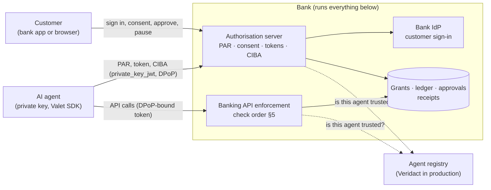

# Veridact Valet: Technical Design

Version 0.1 · 27 October 2026

## 1. Scope and key decisions

**Valet is an open-source profile of OAuth 2.0 standards, with reference code, that a bank deploys and runs itself on the identity platform it already has: the agent never holds a customer credential, every token is bound to the agent's key, every grant is a precise, expiring permission, and every exception goes to the customer in the bank's app.** This document specifies the design and the proof of concept (PoC) that implements it. The product case is in the [README](../README.md).

| Decision | Choice | Why |
| --- | --- | --- |
| Protocol base | OAuth 2.0 authorisation code with PKCE, under the FAPI 2.0 security profile | What bank authorisation servers already run; no new trust model |
| Request integrity | Pushed Authorization Requests (PAR, RFC 9126) | The agent cannot tamper with what the customer sees |
| Permission format | Rich Authorization Requests (RAR, RFC 9396), two types: `valet_accounts` and `valet_payments` | Carries amounts, payees and accounts precisely; standard parsers exist |
| Token binding | DPoP (RFC 9449) on every token | A stolen token is useless without the agent’s private key |
| Exceptions | OpenID CIBA, poll mode, with a one-time `valet_payment_once` authorisation detail | Approval happens in the bank app; the agent only waits |
| Where limits live | The bank’s resource server, in its own ledger | Amounts and payees never leave the bank |
| Agent identity | A pluggable `AgentRegistry`; the PoC uses a static signed list; production uses Veridact | Keeps Valet usable before Veridact is live |
| Who runs it | The bank, in its own environment. Valet is a project, not a hosted service | Banks keep control, data and keys; no customer data leaves the bank |
| Identity provider | The bank's own. Any OpenID Connect provider signs customers in; platforms with PAR, RAR and DPoP can also issue the agent's tokens (§12) | Works with Auth0, Keycloak, Ping, Entra ID, Okta, Curity and others; Valet adds only what the platform lacks |
| Licence | Apache 2.0 | Patent grant and permissive reuse, as banks expect |
| PoC stack | Python 3.13, FastAPI, SQLite, PyJWT, `cryptography` | Same as the Veridact PoC; readable end to end |

**Out of scope for this version:** card payments and shopping baskets (phase 4), a cross-bank dashboard, and agent-to-agent delegation.

### 1.1 What Valet is, and who runs it

**Valet is a project, not a service.** It is an open-source (Apache 2.0) profile of open standards, with reference components, an agent SDK and tests. A bank that adopts it deploys the components in its own environment, next to its own identity platform, and operates them like any other system it owns. There is no Valet cloud between the customer, the agent and the bank: nothing calls home, Valet holds no keys, and no customer data leaves the bank.

A bank can adopt Valet in three ways:

- **Run the reference components**: grant service, enforcement for its banking API, and, if its identity platform lacks the agent features, the Valet authorisation server.
- **Implement the profile on its own stack** and prove it with the conformance tests.
- **Mix the two**, typically Valet's enforcement at its API gateway plus its existing identity platform.

Veridact (the company) can separately offer support, integration help, certification and the agent registry. None of that is needed to run the code.

### 1.2 What Valet provides, and what the bank controls

**Valet supplies the rules and the parts. The bank makes every decision and runs everything.**

| Area | The Valet project provides | The bank decides and runs |
| --- | --- | --- |
| The profile | Permission types and levels as `authorization_details`, approval rules, the check order on every call, error codes, receipt format | Which levels, accounts, limits and grant lengths it offers, within the profile |
| Customer identity | Nothing of its own: it uses the bank's identity provider over OpenID Connect | Its identity provider, sign-in methods (passkeys, biometrics), step-up policy and app |
| Agent tokens | A reference authorisation server (federated mode), or adapters for the bank's own (native mode) | Which mode, and its authorisation server's configuration |
| Enforcement | The checks on every API call, grant service, monthly ledger, approval flow, receipt chain | Where they run (gateway or API), scaling, availability targets |
| Screens | Designs and templates for consent, approvals and the AI agents list, with the content they must show | Brand, wording, languages, its app and push notifications |
| Which agents | The registry interface and a Veridact registry adapter | Admitting agents and withdrawing trust; the registry informs, the bank decides |
| Keys and data | The key and data model | HSM keys, the database, receipt retention, POPIA obligations as responsible party |
| Money and risk | Nothing: Valet never executes a payment | Payments, fraud monitoring, disputes, customer support |
| Operations | Releases, security advisories, conformance tests | Hosting, patching, monitoring, incident response, the conversation with regulators |
| Agent builders | The SDK, and a sandbox bank (the PoC) | Its onboarding terms with agent operators |

### 1.3 "We'll just implement the open standards"

**Good: so does Valet. But ten banks that each implement the standards get ten compliant APIs, and an agent still needs ten integrations.** The standards are the envelope. Valet is the agreed form inside it.

RAR shows why. It carries `authorization_details`, but each implementer defines the types and what they mean. If one bank's "pay my bills" differs from the next bank's, every agent builder integrates bank by bank. Most won't, and customers keep handing over passwords, which is the problem the banks are warning about. Open banking markets reached the same point: the UK, Australia and Brazil each agreed a common profile on top of OAuth and FAPI, because the base standards alone did not give interoperability.

What a bank would otherwise design, build and test alone:

- **A shared vocabulary**: the same permission types, levels and error codes at every bank, so one agent integration works everywhere.
- **The decisions no RFC makes**: checking grant status on every call so pause is instant, a monthly ledger in rands, approvals only for actions the bank itself offered, single-use approvals that never add a beneficiary, what to do when a refresh token is reused, and what the consent and approval screens must show.
- **Working, tested code** for each of these, and tests that prove a deployment behaves.
- **No lock-in**: Apache 2.0, only open standards, and it runs on the identity platform the bank already has. A bank can fork it, or implement the profile itself and use only the tests.

Valet is not a new standard competing with FAPI, and not a replacement for the bank's identity platform. It is the part between the standards and a working, interoperable product.

## 2. Architecture



**Three parties, one place where decisions are made.** The customer signs in and decides only on the bank's own pages. The agent holds a private key and a permission bound to that key, never credentials. Every decision is made at the bank: its authorisation server issues permissions, and its API checks the permission, the grant's live status and the agent's trust on every call, then writes a receipt.

| Component | Responsibility | In the PoC | In a bank |
| --- | --- | --- | --- |
| Valet authorisation server | PAR, consent, token issue, refresh rotation, CIBA approvals | `valet/bank/authz.py`, `web.py` | The bank's own authorisation server (native mode), or this one with the bank's IdP signing customers in (federated mode), §12 |
| Banking API enforcement | The check order in §5 on every call; offers exceptions as `approval_required` | `valet/bank/api.py` | API gateway policy in front of the core banking API |
| Store | Grants, monthly ledger, approvals, offered actions, DPoP replay cache, receipts | SQLite (`store.py`) | Highly available database; signing keys in an HSM |
| Agent registry | Who the agent is, its keys, whether it is still trusted | `StaticRegistry` (`registry.py`) | `VeridactRegistry` (§9) |
| Valet SDK | PAR with PKCE, DPoP proofs, approvals | `valet/agent/sdk.py` | Published SDK for agent operators |
| Customer screens | Consent, approvals, AI agents list, pause and disconnect | Jinja templates | The bank's app, with push notifications |

**Two addresses for one bank.** The agent's server and the customer's browser can reach the bank at different addresses (in Docker Compose, `http://bank:8000` and `http://localhost:8000`). The issuer, the client-assertion audience and browser redirects use the public address. DPoP proofs use the address the request is actually sent to. The SDK keeps both.

## 3. Data model

**Everything lives at the bank; the central object is the grant, which records exactly what one customer allowed one agent to do, and every check on every call reads it live.**

| Entity | Key fields | Notes |
| --- | --- | --- |
| Agent | `client_id`, name, operator, verified, public JWKS, redirect URIs | From the `AgentRegistry` (§9); the agent authenticates with `private_key_jwt` |
| Grant | `grant_id`, customer, agent, level, `authorization_details`, status, created, expires, DPoP key thumbprint (`jkt`), consent evidence hash | Status is `active`, `paused`, `revoked` or `expired`; only `active` lets calls through |
| PAR request | `request_uri`, client, parameters, expiry (60 s) | Single use |
| Authorisation code | code, grant, PKCE challenge, expiry (60 s), used | Single use; bound to the DPoP key at token time |
| Refresh token | opaque, grant, `jkt`, rotated on use | Refused when the grant is not active |
| Approval (CIBA) | `auth_req_id`, grant, exact action, action digest, binding message, status, expiry (5 min), consumed | Status `pending`, `approved`, `denied`, `expired`; consumed once |
| Spend ledger | grant, calendar month (South African time), spent | Integer cents |
| Receipt | sequence, previous hash, record, hash, signature | Append-only chain (§8) |
| DPoP replay cache | proof `jti`, expiry | Rejects reused proofs |

**Permission types (RAR `authorization_details`)**

```json
[
  {"type": "valet_accounts", "actions": ["read_balances", "read_transactions"],
   "accounts": ["acc_4821"], "history_days": 90},
  {"type": "valet_payments", "actions": ["pay_existing_beneficiary"],
   "accounts": ["acc_4821"],
   "limits": {"per_month": {"amount": "2000.00", "currency": "ZAR"}}}
]
```

An exception uses a third type, valid for one action only:

```json
{"type": "valet_payment_once", "from": "acc_4821",
 "to": {"name": "City Power", "account": "30087712"},
 "amount": {"amount": "1250.00", "currency": "ZAR"}, "reference": "Electricity Oct"}
```

**Access levels are templates over these types:** *View only* is `valet_accounts` alone; *Bill payer* adds `valet_payments` with `pay_existing_beneficiary` and a monthly limit. The agent may ask for a level; the customer chooses on the consent screen, and the grant records what the customer chose, not what the agent asked for.

## 4. Connect flow

**The agent pushes a signed request, the customer chooses in the bank’s own screen, and the agent swaps a single-use code for tokens bound to its key.** No step carries a customer credential to the agent.

1. **Push the request (PAR).** The agent posts `response_type=code`, `client_id`, `redirect_uri`, `state`, a PKCE `code_challenge` (S256), its requested `authorization_details`, and a `private_key_jwt` client assertion to `/par`. The bank checks the agent in the `AgentRegistry` and returns a `request_uri` valid for 60 seconds.
2. **Send the customer to the bank.** The agent opens `/authorize?client_id=…&request_uri=…`. The customer signs in to the bank as usual (in production: the bank’s app, with a passkey or biometrics).
3. **Consent.** The bank shows the verified agent name and operator, the access levels, the limit, the accounts and the expiry. The customer picks a level and confirms. The bank stores the grant with the details the customer chose and a hash of the exact consent text shown.
4. **Return a code.** The bank redirects to `redirect_uri` with `code` and `state`. The code is valid for 60 seconds, once.
5. **Exchange for tokens.** The agent posts the code, the PKCE `code_verifier`, a client assertion and a `DPoP` proof header to `/token`. The bank binds the grant to the proof key’s thumbprint (`jkt`) and returns a 5-minute DPoP-bound access token, a rotating refresh token and the granted `authorization_details`.

```http
POST /token HTTP/1.1
DPoP: eyJ0eXAiOiJkcG9wK2p3dCIsImFsZyI6IkVTMjU2Iiwiandr…

grant_type=authorization_code&code=SplxlO…&code_verifier=dBjftJeZ4…
&client_assertion_type=urn:ietf:params:oauth:client-assertion-type:jwt-bearer
&client_assertion=eyJhbGciOiJFUzI1NiJ9…
```

```json
{"access_token": "eyJhbGciOiJFUzI1NiJ9…", "token_type": "DPoP", "expires_in": 300,
 "refresh_token": "r1_7Hq…", "grant_id": "g_3fa8…",
 "authorization_details": [{"type": "valet_payments", "actions": ["pay_existing_beneficiary"], …}]}
```

## 5. Tokens and enforcement at the bank API

**The access token says who and what; the live grant says whether, right now; the ledger says how much is left; the bank checks all three on every call, in a fixed order.**

**Access token claims (JWT, ES256, 5 minutes):** `iss`, `aud` (the bank API), `sub` (a pairwise customer id, different per agent), `client_id`, `grant_id`, `authorization_details`, `cnf.jkt`, `iat`, `exp`, `jti`.

**Check order at the resource server, stopping at the first failure:**

| # | Check | Failure |
| --- | --- | --- |
| 1 | DPoP proof: `typ dpop+jwt`, ES256, `htm` and `htu` match the request, `iat` within 60 s, `jti` unused, `ath` = hash of the token | 401 `invalid_dpop_proof` |
| 2 | Token signature, `aud`, `exp` | 401 `invalid_token` |
| 3 | Proof key thumbprint = `cnf.jkt` | 401 `invalid_token` |
| 4 | Agent still trusted in the `AgentRegistry` | 403 `agent_untrusted` |
| 5 | Grant status is `active` (live lookup) and not expired | 403 `grant_paused`, `grant_revoked` or `grant_expired` |
| 6 | The action is in `authorization_details` (type, action, account) | 403 `insufficient_authorization` |
| 7 | Payments: payee is an existing beneficiary and the month’s total stays within the limit | 403 `approval_required`, with the exact `valet_payment_once` the agent should request |
| 8 | Execute, debit the ledger, write a receipt | 200 with `receipt_id` |

Every outcome, allowed or refused, writes a receipt (§8). Step 5 is a database read on every call: that is what makes pause and revoke immediate, without waiting for tokens to expire.

```json
HTTP/1.1 403 Forbidden
{"error": "approval_required",
 "error_description": "City Power is not an existing beneficiary",
 "authorization_details": [{"type": "valet_payment_once", "from": "acc_4821",
   "to": {"name": "City Power", "account": "30087712"},
   "amount": {"amount": "1250.00", "currency": "ZAR"}, "reference": "Electricity Oct"}]}
```

## 6. Approval flow for exceptions

**An exception becomes a CIBA request for one exact action; the customer approves it in the bank’s app; the agent receives a token that can do that action once, within 5 minutes, and nothing else.**

1. The bank API answers `403 approval_required` with the exact `valet_payment_once` detail (§5).
2. The agent posts to `/bc-authorize`: client assertion, `login_hint` = its `grant_id`, the `authorization_details` it was given, and a short `binding_message` (its note to the customer). The bank refuses if the detail differs from what the API returned for that grant, if the grant is not active, or if the agent has more than 3 pending requests.
3. The bank creates an approval (`auth_req_id`, 5-minute expiry), computes `action_digest` = SHA-256 of the JCS-canonical detail, and sends a push to the customer’s bank app. The prompt is built by the bank from the detail itself, never from agent-supplied text alone: amount, payee, account, “new recipient”, and why it was stopped. The agent’s note is shown separately and labelled as the agent’s words.
4. The agent polls `/token` with `grant_type=urn:openid:params:grant-type:ciba`, `auth_req_id` and a DPoP proof, at the returned `interval` (5 seconds). Pending returns `authorization_pending`; a decline returns `access_denied`.
5. On approval, the bank returns a one-time access token: same `cnf.jkt`, `authorization_details` = that single `valet_payment_once`, `once: true`, `exp` at the approval’s expiry.
6. The agent retries the payment with that token. The API checks that the request matches the detail exactly (by digest), marks the approval consumed, executes and writes a receipt that names the approval.

**Rules:** an approval never adds a beneficiary or raises a limit; it does not count against the monthly limit, because the customer approved the amount directly; a second use, a changed amount or payee, or an expired approval is refused with `approval_invalid`.

## 7. Pause, revoke and expiry

**Stopping an agent is a status change on the grant, read live on every call, so it takes effect on the very next request; nothing waits for a token to expire.**

| Action | Who | Effect | Reversible |
| --- | --- | --- | --- |
| Pause | Customer (dashboard or approval screen), bank fraud team | Every call refused with `grant_paused`; refresh refused; pending approvals cancelled | Yes, by the customer |
| Pause all | Customer | Every grant for that customer paused at once | Yes |
| Revoke (disconnect) | Customer, bank | Grant revoked; refresh tokens deleted | No; the agent must connect again |
| Expiry | Automatic | Grant becomes `expired` at `expires`; renewal needs fresh customer consent | No |
| Agent untrusted | Bank, or Veridact revoking the operator | All grants for that agent refused with `agent_untrusted` (registry cached at most 60 s) | When trust is restored |

Access tokens last 5 minutes, but that is not the safety mechanism: the live grant check is. Short tokens only limit how long a token remains useful if the grant check were ever bypassed.

## 8. Receipts and audit evidence

**Every agent decision, allowed or refused, becomes a signed, hash-chained receipt at the bank; the chain is what settles disputes and backs the liability model.**

```json
{"seq": 42, "prev": "sha256:9c1e…", "time": "2026-10-27T10:42:07+02:00",
 "grant_id": "g_3fa8…", "agent": "kaya", "customer": "cus_thandi",
 "action": "payment", "detail": {"to": "City Power", "amount": "1250.00", "currency": "ZAR"},
 "outcome": "allowed", "basis": "approval", "approval": "ar_51b0…",
 "grant_level": "bill_payer", "consent_hash": "sha256:44d2…"}
```

- `hash` = SHA-256 of the JCS-canonical record; `signature` = ES256 over the hash with the bank’s receipt key. Changing or deleting any receipt breaks every later link.
- `basis` is `grant` (inside the customer’s signed level), `approval` (customer approved in the bank app) or `refused` with a reason. This maps one-to-one onto who carries the liability for each action.
- Customers see their receipts in the agent’s activity page; the bank’s dispute team and auditors verify the chain with `/receipts/verify`.
- Receipts stay at the bank. They hold no card numbers or credentials, and amounts and payees never leave the bank.

## 9. Agent identity and the Veridact interface

**Valet asks one question of the outside world, “is this agent who it says it is, and still trusted?”, through one interface, so the PoC can use a static list and production can use Veridact without other changes.**

```python
class AgentRegistry(Protocol):
    def lookup(self, client_id: str) -> AgentRecord | None: ...   # name, operator, verified, jwks, redirect_uris
    def is_trusted(self, client_id: str) -> bool: ...             # cached at most 60 s
```

| Implementation | Source of truth | Use |
| --- | --- | --- |
| `StaticRegistry` (PoC) | A JSON file signed by the bank | Demo and tests |
| `VeridactRegistry` (target) | The agent’s Veridact presentation at `/par`, verified locally; operator name and tier from the credential; trust from status lists and revocation push | Production |

The consent screen shows the operator name only from the registry, never from the agent’s request, so a copycat cannot name itself after a real agent.

## 10. API reference

**Endpoints as built in the PoC.** Agents authenticate to the authorisation server with `private_key_jwt` (`aud` is the issuer). Every token request and API call also carries a DPoP proof; a 401 includes a `WWW-Authenticate: DPoP` header.

| Endpoint | Caller | Authentication | What it does |
| --- | --- | --- | --- |
| `GET /.well-known/oauth-authorization-server` | Agent | None | Metadata: endpoints, `private_key_jwt`, ES256 DPoP, RAR types, CIBA poll mode |
| `GET /jwks` | Anyone | None | Bank public keys: access tokens (`as-1`) and receipts (`receipts-1`) |
| `POST /par` | Agent | `private_key_jwt` | Push the connect request (PKCE S256, redirect URI, `authorization_details`); returns a `request_uri` valid for 60 seconds |
| `GET /authorize` | Browser | Customer session | Consent screen for a pushed request; asks the customer to sign in first if needed |
| `POST /authorize/decision` | Browser | Session and CSRF token | The customer's choice: creates the grant and a single-use 60-second code, or returns `access_denied` |
| `POST /token` | Agent | `private_key_jwt` and DPoP | `authorization_code` with PKCE; `refresh_token` (rotating, reuse pauses the grant); `urn:openid:params:grant-type:ciba` for an approved action |
| `POST /bc-authorize` | Agent | `private_key_jwt` | Ask the customer to approve one action the API offered. `login_hint` is the grant id. Returns `auth_req_id`, `expires_in` 300, `interval` 2 |
| `GET /api/accounts` | Agent | DPoP-bound token | Balances of the accounts in the grant |
| `GET /api/accounts/{id}/transactions` | Agent | DPoP-bound token | Transactions within the grant's history window (90 days) |
| `POST /api/payments` | Agent | DPoP-bound token (grant or single-use) | Pays, or holds as `approval_required` for a new recipient or over the monthly limit |
| `POST /api/beneficiaries` | Agent | DPoP-bound token | Always refused, and recorded |
| GET /login/callback | Browser | Returning from the bank's IdP | Federated mode: swaps the IdP's code (PKCE), checks the ID token, nonce and, at step-up, auth\_time; maps a claim to the customer |
| POST /internal/grants | The bank's IdP | Shared secret in the PoC; mTLS in production | Native mode: registers a consent (customer, agent, level, account, monthly limit) under the bank's policy ceilings; returns the grant id and authorization\_details for the IdP's tokens |
| GET /internal/grants/{id} | The bank's IdP | As above | Native mode: grant status and spend, checked before issuing or refreshing tokens |
| GET /handoff/consent?ticket= | Browser, sent by the bank's IdP | Ticket signed by the IdP (HS256 in the PoC), 5 minutes, nonce | Native mode: the bank's consent screen for an agent connecting through the IdP; only IdPs in VALET\_HANDOFF\_IDPS, returning only to their registered address |
| POST /handoff/decision | Browser | The same ticket, single use | Creates the grant from the customer's choice under the bank's policy, then auto-posts a signed result (grant id or deny, same nonce) back into the IdP's login |
| DELETE /internal/grants/{id} | The bank's IdP | Shared secret in the PoC; mTLS in production | Native mode: the customer disconnected the agent in the IdP's own account pages; revokes the grant and writes a receipt |

Customer and operations pages on the bank: `GET/POST /login`, `POST /logout`, `GET /app`, `GET /app/agents/{grant}`, `POST /app/agents/{grant}/{pause|resume|revoke}`, `POST /app/pause-all`, `GET /app/approvals`, `GET/POST /app/approvals/{id}`, `GET /ops`, `POST /ops/agents/{client_id}/trust`, `GET /receipts/verify`.

**A payment inside the grant:**

```http
POST /api/payments
Authorization: DPoP eyJhbGciOiJFUzI1NiIs...
DPoP: eyJ0eXAiOiJkcG9wK2p3dCIs...

{"from_account": "acc_4821", "to": {"name": "Water & Sanitation", "account": "40021187"},
 "amount": "640.00", "reference": "Water Oct"}

HTTP/1.1 200 OK
{"status": "paid", "to": "Water & Sanitation", "amount": "640.00", "currency": "ZAR",
 "receipt": "sha256:...", "spent_this_month": "640.00", "monthly_limit": "2000.00"}
```

**Errors from the banking API:**

| Error | HTTP | Meaning | What the agent does |
| --- | --- | --- | --- |
| `invalid_token`, `invalid_dpop_proof` | 401 | Token or proof missing, invalid, replayed or bound to another key | Get a fresh token; check the clock and the URL it signs |
| `agent_untrusted` | 403 | The bank or Veridact has withdrawn trust in the operator | Stop; the operator contacts the bank |
| `grant_paused` | 403 | The customer paused the agent | Tell the customer; try again after they resume |
| `grant_revoked`, `grant_expired` | 403 | The permission has ended | Start a new connect |
| `insufficient_authorization` | 403 | Outside the grant, or adding a beneficiary | Ask the customer to change access in the bank app |
| `approval_required` | 403 | The bank offers this exact action for approval; the body carries `authorization_details` | Send it unchanged to `/bc-authorize` |
| `approval_invalid` | 403 | Single-use token already used, expired, or for a different action | Ask for a new approval |
| `insufficient_funds` | 422 | Not enough money in the account | Tell the customer |

At `/token` and `/bc-authorize`: `authorization_pending` (keep polling at `interval`), `slow_down` (three approvals already waiting), `expired_token` (the customer did not answer in time), `access_denied` (declined or cancelled), `invalid_grant` (bad code or verifier, refresh reuse, or a second token for one approval), `invalid_authorization_details` (an action the API did not offer), `unauthorized_client` (unknown or untrusted agent).

## 11. Security considerations

**The design assumes the agent can be tricked and the customer can be coached; it therefore never lets the agent write what the customer approves, and never lets an approval widen the grant.**

| Threat | Control |
| --- | --- |
| Agent tampers with what the customer sees | PAR: parameters are pushed server-to-server and signed by client assertion; the consent screen renders from the stored request and the registry, not from URL parameters |
| Prompt injection makes the agent pay a fraudster | New payees always need an approval; the approval prompt is built by the bank from the payment detail; limits cap damage within the grant |
| Customer coached to approve | The prompt shows payee, amount, “new recipient”, and the bank’s scam warning; the bank’s own fraud scoring still runs on approved payments |
| Stolen access or refresh token | DPoP binding (`cnf.jkt`), 5-minute access tokens, refresh rotation with reuse detection that pauses the grant |
| Replayed DPoP proof | `jti` cache, 60-second `iat` window, `htm`/`htu`/`ath` checks |
| Approval reused or altered | Single use, 5-minute expiry, digest match on the exact payment |
| Copycat agent | Operator name only from the registry (Veridact in production); unknown or untrusted agents refused at `/par` |
| Algorithm confusion | Only ES256 accepted for client assertions, DPoP proofs and tokens |
| Customer locked out of control | Pause and revoke are always available in the bank app, independent of the agent |

**Not handled in this version:** a malicious agent acting within a customer’s standing limit (bounded by the limit, recorded in receipts, revocable), and device-level compromise of the customer’s banking app (the bank’s existing controls apply).

## 12. Identity providers: Auth0, Keycloak, Ping, Entra ID and others

**Valet never replaces the bank's identity platform. Customer sign-in needs only plain OpenID Connect, which every provider offers. The bank's own authorisation server can also issue the agent's tokens where it supports the profile.** Feature support changes between versions, so confirm each item on the bank's exact product and plan during pilot scoping.

**Two deployment modes. The banking API's checks are identical in both.**

|  | Federated mode | Native mode |
| --- | --- | --- |
| Who issues the agent's tokens | Valet's authorisation server, deployed by the bank | The bank's own authorisation server |
| Who signs the customer in | The bank's identity provider, over OpenID Connect | The bank's identity provider |
| Works with | Any OpenID Connect provider | Platforms with PAR, RAR and DPoP (CIBA too, if approvals run in the IdP) |
| Work on the bank's side | Register one OIDC client, choose the claim that identifies the customer, set the step-up policy | Configure Valet's RAR types; add a hook that registers each consent with Valet's grant service (`POST /internal/grants`) and puts the grant id in tokens; point Valet's enforcement at the IdP's keys |
| Built in the PoC | `idp.py`; run against Keycloak 26.4.0 | `tokens.py`, `grants.py`, `handoff.py`, and the Keycloak extension; run against Keycloak 26.4.0 |

In native mode the consent the customer gave is the grant registered with Valet, so a token can never widen it. A single-use approval token from the IdP's own CIBA is accepted only for an action the bank's API offered, matching it exactly, and only once.

**Support for the agent-side features, as of October 2026:**

| Platform | PAR | RAR | DPoP | CIBA | Fits |
| --- | --- | --- | --- | --- | --- |
| PingFederate | Yes | Yes, configurable types | Confirm on version | Yes, poll and ping | Native or federated |
| Auth0 | Yes, Highly Regulated Identity add-on | Yes, Highly Regulated Identity | Yes | Yes, poll, with RAR, Guardian push; Enterprise | Native on Enterprise with Highly Regulated Identity, else federated. Docs list DPoP for code and refresh grants, not CIBA: confirm |
| Keycloak 26.4+ | Yes | No general support | Yes, supported from 26.4 | Yes, poll and ping, through an authentication channel | Native with the Valet extension (built and run), or federated |
| Okta | Yes | Not documented | Yes | Yes, poll (Transactional Verification) | Federated |
| Microsoft Entra ID | No | No | No | No | Federated |
| Curity | Yes | Yes (confirm detail types) | Yes | Yes, certified | Native |
| Any other OIDC provider |  |  |  |  | Federated |

Keycloak's row was confirmed against a running Keycloak 26.4.0: its metadata advertises PAR, CIBA (poll and ping), DPoP and `private_key_jwt`, and no RAR types.

**Notes by platform:**

- **Auth0.** Federated: a Regular Web Application. Use `email` or a customer-number claim added by an Action as the customer claim; Valet asks for `max_age=0` at step-up and checks `auth_time`. Native: an Action registers the consent and adds the `valet_grant` claim; Universal Login templates show the RAR details; approvals can use CIBA with Guardian push.
- **Keycloak.** Both modes run end to end on Keycloak 26.4.0. Federated: the realm file in the repo and `docker-compose.keycloak.yml`. Native: the Valet extension (`extensions/keycloak-valet`, Java). After Keycloak signs the customer in, it hands them to Valet's consent screen with a signed ticket. It then checks Valet's signed answer, and puts the grant id in the agent's DPoP-bound tokens as `valet_grant`. RAR is not needed, because the customer's choice is made on Valet's screen. Approvals stay with Valet's CIBA, and Valet binds the grant to the agent's key on first use.
- **PingFederate.** Native: Valet's RAR types and processor, an access-token mapping for the grant claim, and CIBA with the bank's push authenticator. Confirm PAR and DPoP on the version in use; otherwise enforce DPoP at the gateway.
- **Microsoft Entra ID and Entra External ID.** Federated: Entra stays the customer identity provider, and Valet's authorisation server adds the agent features Entra does not provide.
- **Okta.** Federated, because RAR is not documented. DPoP and CIBA exist, so revisit native mode if RAR arrives.

**The native-mode hook, by pattern.** Each IdP needs one small piece so that Valet holds the grant and the IdP's tokens carry its id:

| Pattern | How it works | Where it fits |
| --- | --- | --- |
| **Consent hand-off** (recommended) | The IdP signs the customer in, then hands them to Valet's consent screen mid-login with a signed ticket. Valet registers the grant and posts a signed result back, and the IdP adds `valet_grant` to its tokens. | Keycloak (built: an authenticator plus a protocol mapper); Auth0 (an Action using redirect and continue); PingFederate (a policy step or adapter) |
| **Register after IdP consent** | The IdP runs its own consent screen, then calls `POST /internal/grants` and adds the returned id to its tokens. | IdPs whose consent screen can show Valet's levels. The customer can only accept or decline, not choose less. |

Whichever pattern, the IdP tells Valet about disconnects made in its own account pages (`DELETE /internal/grants/{id}`), and fails closed if Valet cannot be reached. Valet enforces the registered grant, never the token's own claims, so a misconfigured hook cannot widen access.

**Live results on Keycloak 26.4.0 (native mode).**

- **Connect:** Kaya connected through Keycloak (PAR, sign-in, Valet consent hand-off, DPoP token). Valet's own authorisation server issued no tokens.
- **Payments and approvals:** Kaya paid within its limit; a new recipient was approved in the bank app and paid once; a beneficiary add was refused.
- **Refresh:** a 60-second Keycloak token refreshed and kept its grant.
- **Stopping:** a pause in the bank app stopped the still-valid Keycloak token at once, and an IdP-side disconnect revoked the grant.
- **Customer choices:** "View only" chosen at consent made payments refuse; cancelling gave Kaya `access_denied`.
- **Forgeries:** a result signed with the wrong key, and a correctly signed result carrying another login's nonce, were both refused by the extension.

The extension uses Keycloak's internal authenticator and protocol-mapper SPIs, as every custom extension of these kinds does, so it needs re-testing on each Keycloak upgrade. The PoC hand-off uses one shared HS256 secret in both directions; production should use asymmetric keys, each side verifying the other's JWKS.

**Sources:** [Auth0 Highly Regulated Identity](https://auth0.com/docs/secure/highly-regulated-identity), [Auth0 CIBA](https://auth0.com/docs/get-started/authentication-and-authorization-flow/client-initiated-backchannel-authentication-flow/user-authorization-with-ciba), [Auth0 DPoP](https://auth0.com/docs/secure/sender-constraining/demonstrating-proof-of-possession-dpop), [Keycloak 26.4 DPoP support](https://www.keycloak.org/2025/10/dpop-support-26-4), [Okta CIBA](https://developer.okta.com/blog/2025/07/31/ciba-okta), [Okta DPoP](https://developer.okta.com/docs/guides/dpop/nonoktaresourceserver/main/), [Curity DPoP](https://curity.io/docs/identity-server/profiles/token-profile/clients/client-config/dpop), [Curity CIBA certification](https://curity.io/news/certified-ciba-compliance/).

## 13. Proof of concept

**A working bank and agent that show every promise in this design.** The PoC is Python 3.11+ with FastAPI. It contains Marula Bank (a fictional bank with a minimal authorisation server, a banking API and the customer's AI agents screens) and Kaya (a fictional money assistant built on the Valet SDK). It is delivered as a zip with a README, Apache 2.0 licence, `requirements.txt`, Dockerfile and Docker Compose file.

**Run it:**

```bash
pip install -r requirements.txt
python demo.py          # scripted end-to-end run: 13 steps, 22 checks
python -m pytest -q     # 49 behaviour tests, including both identity-provider modes and the consent hand-off
python run.py           # clickable: Kaya http://localhost:8001, Marula Bank http://localhost:8000 (thandi / demo)

docker compose up --build        # the same clickable demo in containers
docker compose run --rm demo     # the scripted run
docker compose -f docker-compose.yml -f docker-compose.keycloak.yml up --build   # customers sign in with Keycloak

# native mode on Keycloak: see extensions/keycloak-valet/README.md
(cd extensions/keycloak-valet && KEYCLOAK_HOME=... ./build.sh)
python deploy/keycloak/setup_native.py
```

**What the scripted run proves**, step by step. It exits non-zero if any check fails.

| Step | What happens | Promise shown |
| --- | --- | --- |
| 1 | A copycat agent tries to connect | Unverified agents are refused before the customer sees anything |
| 2 | Thandi connects Kaya | No credentials shared; consent shows the verified operator; token is key-bound |
| 3 | Kaya's token is stolen and a request replayed | A stolen token or replayed proof is refused |
| 4 | Kaya pays the water bill | Existing beneficiary inside the limit: paid with no prompt |
| 5 | Kaya pays City Power, a new recipient | Held; the bank builds the approval screen; approved payment goes through once |
| 6 | Kaya reuses an approval, then changes the amount | Both refused |
| 7 | School fees over the monthly limit; Thandi declines | Held, then nothing paid |
| 8 | Kaya tries to add a beneficiary | Always refused |
| 9 | Thandi pauses, then resumes | Effective on the next call; a paused grant cannot refresh |
| 10 | A copied refresh token is used | Reuse detected; the grant pauses |
| 11 | Trust in Kaya's operator is withdrawn | Every grant for Kaya stops at once |
| 12 | Thandi disconnects Kaya | Immediate and final |
| 13 | A receipt is altered | The signed hash chain shows exactly where |

**Verified on 27 October 2026:** 22 of 22 checks and 49 of 49 tests passed, including from a clean virtual environment built only from `requirements.txt`. The clickable demo was driven end to end in a browser at phone width, including with the agent reaching the bank at a different address from the browser, as in Docker Compose. Both deployment modes were run against **Keycloak 26.4.0**. Federated: sign-in on Keycloak's page, consent, payment, and an approval that forced a fresh Keycloak sign-in (with `auth_time` checked). Native: the Valet extension issued Kaya's tokens from Keycloak, with the results listed in §12. The Docker images were not built in that environment (no Docker daemon), and the extension was compiled with `javac` against Keycloak's own libraries because Maven Central was not reachable.

**Not in the PoC** (a bank deployment needs these): passkeys or biometrics in the bank's IdP instead of a demo password; push notifications to the bank app; keys in an HSM or KMS rather than files; shared, highly available storage instead of SQLite; TLS and usually mTLS or a gateway (including mTLS for the grant service and asymmetric keys for the consent hand-off); the Veridact registry instead of `StaticRegistry`; native-mode hooks for Auth0 (an Action) and PingFederate, and Keycloak account-console disconnects reaching Valet (an event listener); runs against real Auth0, Entra ID, Okta and Ping tenants; a run through the OpenID FAPI 2.0 conformance suite.

**Next steps:** run federated sign-in against the pilot bank's own IdP tenant; build the native-mode hook for that IdP if it qualifies (§12); `VeridactRegistry` against the Veridact directory; push approvals into a test build of a bank app; load-test the live status check on every call.
