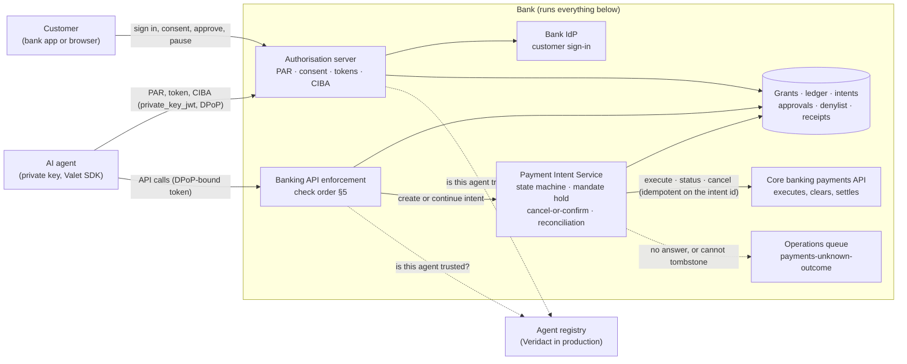
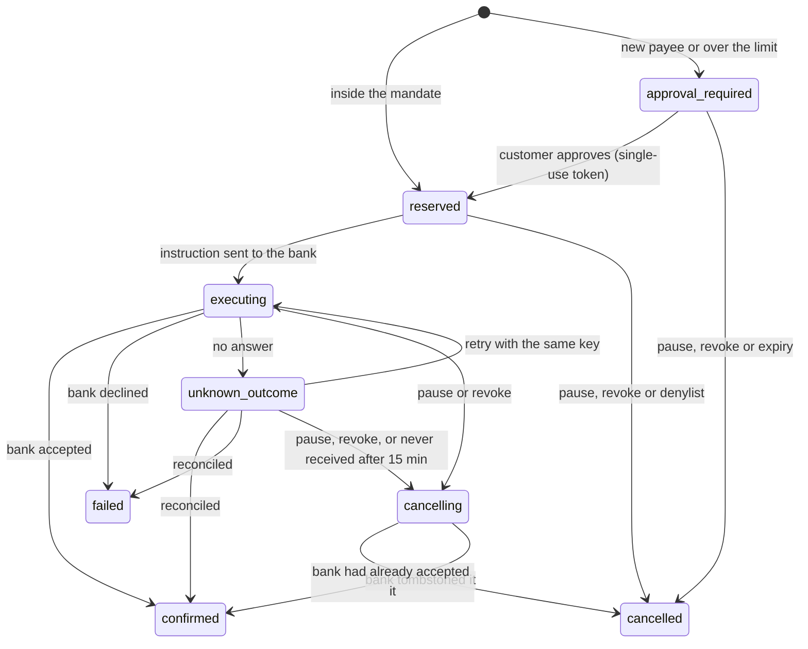

# Veridact Valet: Technical Design

Version 0.6 · 16 November 2026

## 1. Scope and key decisions

**Valet is an open-source profile of OAuth 2.0 standards, with reference code, that a bank deploys and runs itself on the identity platform it already has: the agent never holds a customer credential, every grant is bound to the agent's key when the customer consents, every grant is a precise, expiring permission, every exception goes to the customer in the bank's app, and Valet is an authorisation and transaction-control layer that initiates execution through a bank-controlled payment API: it never executes a payment itself.** This document specifies the design and the proof of concept (PoC) that implements it. The product case is in the [README](../README.md); what Valet is, where it fits next to open banking and the identity platform, and the questions banks ask are in [Where Valet fits](where-valet-fits.md).

| Decision | Choice | Why |
| --- | --- | --- |
| Protocol base | OAuth 2.0 authorisation code with PKCE. The direct API is aligned with the FAPI 2.0 Security Profile, with conformance pending and the known differences listed in §14.1; the MCP gateway's bearer tier is outside it (§14) | What bank authorisation servers already run; no new trust model |
| Request integrity | Pushed Authorization Requests (PAR, RFC 9126) | The request reaches the bank on an authenticated back channel, so nothing in the browser can change what the customer sees. PAR does not sign the request; a separately verifiable signed request would need JAR (RFC 9101), which FAPI 2.0 does not require |
| Permission format | Rich Authorization Requests (RAR, RFC 9396), two types: `valet_accounts` and `valet_payments` | Carries amounts, payees and accounts precisely; standard parsers exist |
| Token binding | DPoP (RFC 9449) on every token on the direct API. The agent names its key in the pushed request (`dpop_jkt`), so the grant and the authorisation code are bound to it before any token exists (§4, §12). Assistant platforms that cannot send DPoP yet get bearer-tier ceilings (§14) | A stolen token or authorisation code is useless without the agent’s private key |
| Exceptions | OpenID CIBA, poll mode, with a one-time `valet_payment_once` authorisation detail | Approval happens in the bank app; the agent only waits |
| Where limits live | The bank’s resource server, in its own ledger | Amounts and payees never leave the bank |
| Payments | Valet authorises, holds headroom on the mandate and initiates one idempotent instruction through the bank-controlled payments API, which executes. One durable payment intent per request; a hold is released only when the bank confirms, declines or tombstones the instruction (cancel-or-confirm, §5.1) | A retry, a crash, a timeout or a pause can never pay twice or lose track of money, and Valet stays out of the money path |
| Agent identity | A pluggable `AgentRegistry`; the PoC uses a static signed list; production uses Veridact. Vendor-hosted client metadata (CIMD) accepted only from an allowlist; never Dynamic Client Registration (§9.2, proposed) | Keeps Valet usable before Veridact is live; no anonymous clients |
| Who runs it | The bank, in its own environment. Valet is a project, not a hosted service | Banks keep control, data and keys; no customer data leaves the bank |
| Identity provider | The bank's own. Any OpenID Connect provider signs customers in; platforms with PAR, RAR and DPoP can also issue the agent's tokens (§12) | Works with Auth0, Keycloak, Ping, Entra ID, Okta, Curity and others; Valet adds only what the platform lacks |
| Licence | Apache 2.0 | Patent grant and permissive reuse, as banks expect |
| PoC stack | Python 3.13, FastAPI, SQLite, PyJWT, `cryptography` | Same as the Veridact PoC; readable end to end |

**Out of scope for this version:** card payments and shopping baskets (phase 4), a cross-bank dashboard, and agent-to-agent delegation.

### 1.1 What Valet is, and who runs it

**Valet is a project, not a service.** It is an open-source (Apache 2.0) profile of open standards, with reference components, an agent SDK and tests. A bank that adopts it deploys the components in its own environment, next to its own identity platform, and operates them like any other system it owns. There is no Valet cloud between the customer, the agent and the bank: nothing calls home, Valet holds no keys, and no customer data leaves the bank.

A bank can adopt Valet in three ways:

- **Run the reference components**: grant service, enforcement for its banking API, and, if its identity platform lacks the agent features, the Valet authorisation server.
- **Implement the profile on its own stack** and prove it with the conformance tests.
- **Mix the two**, typically Valet's enforcement at its API gateway plus its existing identity platform.

Veridact (the company) can separately offer support, integration help, certification and the agent registry. None of that is needed to run the code.

### 1.2 What Valet provides, and what the bank controls

**Valet supplies the rules and the parts. The bank makes every decision and runs everything.**

| Area | The Valet project provides | The bank decides and runs |
| --- | --- | --- |
| The profile | Permission types and levels as `authorization_details`, approval rules, the check order on every call, error codes, receipt format | Which levels, accounts, limits and grant lengths it offers, within the profile |
| Customer identity | Nothing of its own: it uses the bank's identity provider over OpenID Connect | Its identity provider, sign-in methods (passkeys, biometrics), step-up policy and app |
| Agent tokens | A reference authorisation server (federated mode), or adapters for the bank's own (native mode) | Which mode, and its authorisation server's configuration |
| Enforcement | The checks on every API call, grant service, monthly ledger, approval flow, receipt chain | Where they run (gateway or API), scaling, availability targets |
| Screens | Designs and templates for consent, approvals and the AI agents list, with the content they must show | Brand, wording, languages, its app and push notifications |
| Which agents | The registry interface and a Veridact registry adapter | Admitting agents and withdrawing trust; the registry informs, the bank decides |
| Keys and data | The key and data model | HSM keys, the database, receipt retention, POPIA obligations as responsible party |
| Money and risk | The payment intent, the hold against the mandate and one idempotent instruction to the bank's payments API (§5.1). Valet never executes a payment | Payment execution, clearing and settlement, reconciliation answers, fraud monitoring, disputes, customer support |
| Operations | Releases, security advisories, conformance tests | Hosting, patching, monitoring, incident response, the conversation with regulators |
| Agent builders | The SDK, and a sandbox bank (the PoC) | Its onboarding terms with agent operators |

### 1.3 "We'll just implement the open standards"

**Good: so does Valet. But ten banks that each implement the standards get ten compliant APIs, and an agent still needs ten integrations.** The standards are the envelope. Valet is the agreed form inside it.

RAR shows why. It carries `authorization_details`, but each implementer defines the types and what they mean. If one bank's "pay my bills" differs from the next bank's, every agent builder integrates bank by bank. Most won't, and customers keep handing over passwords, which is the problem the banks are warning about. Open banking markets reached the same point: the UK, Australia and Brazil each agreed a common profile on top of OAuth and FAPI, because the base standards alone did not give interoperability.

What a bank would otherwise design, build and test alone:

- **A shared vocabulary**: the same permission types, levels and error codes at every bank, so one agent integration works everywhere.
- **The decisions no RFC makes**: checking grant status on every call so pause is instant, a monthly ledger in rands, approvals only for actions the bank itself offered, single-use approvals that never add a beneficiary, what to do when a refresh token is reused, and what the consent and approval screens must show.
- **Working, tested code** for each of these, and tests that prove a deployment behaves.
- **No lock-in**: Apache 2.0, only open standards, and it runs on the identity platform the bank already has. A bank can fork it, or implement the profile itself and use only the tests.

Valet is not a new standard competing with FAPI, and not a replacement for the bank's identity platform. It is the part between the standards and a working, interoperable product.

### 1.4 Where Valet fits

**Valet sits between the bank's identity platform and its banking APIs: the platform says who the customer is, open banking consent says what they agreed to, and Valet checks every agent action against that agreement and records the outcome.** It extends the bank's open banking consent model rather than replacing it, and runs on the bank's identity platform (PingFederate, Keycloak, Entra ID and others) rather than competing with it. The layer-by-layer view, the answers to the questions bank reviews ask, and the mapping to AP2, Verifiable Intent and the Personal Agent Protocol are in [Where Valet fits](where-valet-fits.md).

## 2. Architecture



**Three parties, one place where decisions are made.** The customer signs in and decides only on the bank's own pages. The agent holds a private key and a permission bound to that key, never credentials. Every decision is made at the bank: its authorisation server issues permissions, and its API checks the permission, the grant's live status and the agent's trust on every call, then writes a receipt. Money moves only in the bank's own payment system, on one idempotent instruction that Valet's Payment Intent Service initiates; the bank's payments API executes it.

| Component | Responsibility | In the PoC | In a bank |
| --- | --- | --- | --- |
| Valet authorisation server | PAR, consent, token issue, refresh rotation, CIBA approvals | `valet/bank/authz.py`, `web.py` | The bank's own authorisation server (native mode), or this one with the bank's IdP signing customers in (federated mode), §12 |
| Banking API enforcement | The check order in §5 on every call; offers exceptions as `approval_required` | `valet/bank/api.py` | API gateway policy in front of the core banking API |
| Payment Intent Service | One durable record per payment: idempotency, the hold against the mandate, the state machine, cancel-or-confirm, reconciliation and escalation to operations (§5.1). Shared by the direct API, the MCP gateway and pause and revoke | `valet/bank/payments.py` | The same component, on the bank's database (Postgres in the POC, §17) |
| Core banking adapter | Hands the bank one idempotent instruction per intent, reads back the outcome, and asks the bank to cancel-or-confirm. The only place Valet touches the payment system | `valet/bank/core.py`: `DemoCore`, a fictional core in the same SQLite file | An adapter for the bank's payments API, passing the intent id as its idempotency key |
| Store | Grants, monthly ledger, payment intents, approvals, offered actions, DPoP replay cache, the bank's denylist, receipts | SQLite (`store.py`) | Highly available database; signing keys in an HSM |
| Agent registry | Who the agent is, its keys, whether it is still trusted | `StaticRegistry` (`registry.py`) | `VeridactRegistry` (§9) |
| Valet SDK | PAR with PKCE, DPoP proofs, approvals | `valet/agent/sdk.py` | Published SDK for agent operators |
| Customer screens | Consent, approvals, AI agents list, pause and disconnect | Jinja templates | The bank's app, with push notifications |

**Two addresses for one bank.** The agent's server and the customer's browser can reach the bank at different addresses (in Docker Compose, `http://bank:8000` and `http://localhost:8000`). The issuer, the client-assertion audience and browser redirects use the public address. DPoP proofs use the address the request is actually sent to. The SDK keeps both.

## 3. Data model

**Everything lives at the bank; the central object is the grant, which records exactly what one customer allowed one agent to do, and every check on every call reads it live.**

| Entity | Key fields | Notes |
| --- | --- | --- |
| Agent | `client_id`, name, operator, verified, public JWKS, redirect URIs | From the `AgentRegistry` (§9); the agent authenticates with `private_key_jwt` |
| Grant | `grant_id`, customer, agent, level, `authorization_details`, status, created, expires, DPoP key thumbprint (`jkt`), consent evidence hash | Status is `active`, `paused`, `revoked` or `expired`; only `active` lets calls through. `jkt` is set when the customer consents, from the key the agent named during authorisation |
| PAR request | `request_uri`, client, parameters, `dpop_jkt`, expiry (60 s) | Single use |
| Authorisation code | code, grant, PKCE challenge, expiry (60 s), used | Single use; redeemed only with a proof from the key the grant was bound to at consent |
| Refresh token | opaque, grant, `jkt`, rotated on use, time of use | Refused when the grant is not active. A used token is accepted again for 60 seconds from the same key (§4.1); after that, reuse pauses the grant |
| Approval (CIBA) | `auth_req_id`, grant, exact action, action digest, binding message, status, expiry (5 min), consumed | Status `pending`, `approved`, `denied`, `expired`; consumed once, by the payment intent it was requested for |
| Payment intent | `payment_intent_id` (server-generated), grant, agent, Idempotency-Key, request digest, exact payment, amount, month, state, basis, approval, channel (direct API or MCP gateway), the bank's payment id, stored outcome | One per grant and key. States and rules in §5.1 |
| Spend ledger | grant, calendar month (South African time), spent | Integer cents. Changed only when the bank confirms a payment; money held for unconfirmed payments is the sum of held intents |
| Receipt | sequence, previous hash, record, hash, signature | Append-only chain (§8) |
| DPoP replay cache | proof `jti`, expiry | Rejects reused proofs |

**Permission types (RAR `authorization_details`)**

```json
[
  {"type": "valet_accounts", "actions": ["read_balances", "read_transactions"],
   "accounts": ["acc_4821"], "history_days": 90},
  {"type": "valet_payments", "actions": ["pay_existing_beneficiary"],
   "accounts": ["acc_4821"],
   "limits": {"per_month": {"amount": "2000.00", "currency": "ZAR"}}}
]
```

An exception uses a third type, valid for one action only:

```json
{"type": "valet_payment_once", "from": "acc_4821",
 "to": {"name": "City Power", "account": "30087712"},
 "amount": {"amount": "1250.00", "currency": "ZAR"}, "reference": "Electricity Oct"}
```

**Access levels are templates over these types:** *View only* is `valet_accounts` alone; Approved payer adds valet\_payments, with every payment sent to the customer for approval in the bank app (the pilot default). *Bill payer* adds `valet_payments` with `pay_existing_beneficiary`, a per-payment cap, a maximum number of payments a month, and a monthly limit. The agent may ask for a level; the customer chooses on the consent screen, and the grant records what the customer chose, not what the agent asked for.

### 3.1 Target data model: versioned mandates (proposed)

**Mandate references are normative from version 0.6; mandate versions beyond 1 are deferred.** Every grant records its mandate version (always 1 today, because a mandate cannot be edited) and, in native mode, the token issuer it was made with. Every payment intent records the mandate version it was checked against, and every receipt for a grant carries `"mandate": {"id": "<grant id>", "version": 1}`. Agents, the MCP gateway and dispute tools can rely on these fields now; when editing arrives (below), only the version number changes. Built and tested (`tests/test_stopping.py`).

The PoC's grant is one row whose terms and status change in place. The target model splits it into a stable **mandate** and immutable **mandate versions**, so every receipt names the exact terms that applied when the agent acted. Audit and disputes depend on this record, and it is the same record as the MCP gateway's mandate.

| Entity | Key fields | Rules |
| --- | --- | --- |
| Mandate | mandate\_id, customer, pairwise sub, client\_id, status, current\_version, jkt, created | Stable identity; the token carries only mandate\_id. Status mirrors the latest status event |
| Mandate version | mandate\_id, version, level, authorization\_details, intent, consent text hash, consent evidence (acr, auth\_time), change (create, narrow, widen, renew), changed by, valid\_from, expires, supersedes | Never updated or deleted. Narrowing needs no new consent; widening and renewal need the consent screen and step-up |
| Status event | mandate\_id, status (active, paused, revoked, expired), actor, reason, time | Append-only: pause, resume and revoke are events, not edits |
| Ledger | mandate\_id, month (South African time), spent, count, reserved | Changed only inside the locked limit check |
| Payment intent | As built (§5.1), plus mandate\_id and version | The reservation and the idempotency record in one row: held by the limit check, confirmed when the bank pays, released when it declines. Unique per agent and key; a retry returns the stored outcome |
| Approval | As today, plus mandate\_id and version | Single use; counts towards the month's total and count |
| Receipt | As today, plus mandate\_id, version, idempotency key, triggering instruction (agent-supplied, labelled), policy result, risk score | One hash chain per mandate |

The payment detail gains named payees, a per-payment cap, a payment count and an approval mode:

```json
{
  "type": "valet_payments",
  "actions": ["pay_existing_beneficiary"],
  "accounts": ["acc_123"],
  "payees": ["ben_water", "ben_city_power"],
  "approval": "approved_payer",
  "limits": {
    "per_payment": { "amount": "1000.00", "currency": "ZAR" },
    "per_month": { "amount": "2000.00", "currency": "ZAR", "count": 4 }
  }
}
```

**How it is used.** Enforcement reads the mandate's current version on every call (§5). Each receipt names the version it was checked against, so a dispute replays the exact terms in force, even after the customer has narrowed or renewed the mandate.

**Migration from the PoC.** Each grant becomes a mandate with version 1 and approval bill\_payer. Payees are set to the beneficiaries that exist at migration, never to "all beneficiaries, including future ones": a beneficiary the customer adds later is not covered until the customer adds it to the mandate. This narrows the PoC's rule (any saved beneficiary), and narrowing needs no new consent; migration never widens what the customer agreed to.

**When a version changes.** Enforcement always uses the current version. A token minted before a narrowing carries no terms of its own, so it is checked against the narrowed mandate on its next call. A one-time approval names the version it was given under: narrowing leaves it valid if the action still fits, and widening or renewal never extends it.

## 4. Connect flow

**The agent pushes its request to the bank on an authenticated back channel and names its key, the customer chooses in the bank’s own screen, and the agent swaps a single-use code for tokens bound to that key.** No step carries a customer credential to the agent.

1. **Push the request (PAR).** The agent posts `response_type=code`, `client_id`, `redirect_uri`, `state`, a PKCE `code_challenge` (S256), its requested `authorization_details`, `dpop_jkt` (the thumbprint of its DPoP key, RFC 9449 §10; a DPoP proof on the request is accepted instead), and a `private_key_jwt` client assertion to `/par`. The bank checks the agent in the `AgentRegistry` and returns a `request_uri` valid for 60 seconds. A request that names no key is refused. The client assertion authenticates the agent; it does not sign the request parameters.
2. **Send the customer to the bank.** The agent opens `/authorize?client_id=…&request_uri=…`. The customer signs in to the bank as usual (in production: the bank’s app, with a passkey or biometrics).
3. **Consent.** The bank shows the verified agent name and operator, the access levels, the limit, the accounts and the expiry. The customer picks a level and confirms. The bank stores the grant with the details the customer chose, a hash of the exact consent text shown, and the agent's key thumbprint: the grant is bound to the key here, before any token or API call exists.
4. **Return a code.** The bank redirects to `redirect_uri` with `code`, `state` and `iss` (RFC 9207), which the SDK checks. The code is valid for 60 seconds, once.
5. **Exchange for tokens.** The agent posts the code, the PKCE `code_verifier`, a client assertion and a `DPoP` proof header to `/token`. The bank checks that the proof key is the key the grant was bound to at consent, and refuses any other, so a stolen code is useless even with the agent's client credentials. It returns a 5-minute DPoP-bound access token, a rotating refresh token and the granted `authorization_details`.

```http
POST /token HTTP/1.1
DPoP: eyJ0eXAiOiJkcG9wK2p3dCIsImFsZyI6IkVTMjU2Iiwiandr…

grant_type=authorization_code&code=SplxlO…&code_verifier=dBjftJeZ4…
&client_assertion_type=urn:ietf:params:oauth:client-assertion-type:jwt-bearer
&client_assertion=eyJhbGciOiJFUzI1NiJ9…
```

```json
{"access_token": "eyJhbGciOiJFUzI1NiJ9…", "token_type": "DPoP", "expires_in": 300,
 "refresh_token": "r1_7Hq…", "grant_id": "g_3fa8…",
 "authorization_details": [{"type": "valet_payments", "actions": ["pay_existing_beneficiary"], …}]}
```

### 4.1 Refresh tokens: rotation, with a short retry window

**Valet rotates refresh tokens on every use, lets an agent that lost the response retry for 60 seconds with the same key, and pauses the grant on any other reuse.**

- **Rotation.** Each refresh returns a new refresh token and retires the one presented.
- **Retry window.** If the response is lost, the agent may present the token it just used again within 60 seconds, with a DPoP proof from the same key and the same client authentication. It gets a fresh pair, the successor it never received is withdrawn, and a receipt records the retry. One grant never has two live refresh tokens.
- **Reuse.** A used token presented after the window, or at any time with a different key or client, means a copy exists: the grant is paused, the customer sees it in the bank app, and a receipt is written.
- The window is a bank setting (`refresh_retry_window`); 0 turns the retry off.

**Why Valet rotates, although FAPI 2.0 says not to.** The FAPI 2.0 Security Profile (5.3.2.1, item 9) bars refresh token rotation except in extraordinary circumstances, on the reasoning that a sender-constrained refresh token is useless without the client's private key. That reasoning rests on the key staying private, and **the bank does not control the agent's private key**. It sits in the agent operator's infrastructure, under the operator's custody and controls. If the key and a refresh token are copied together, a static refresh token gives a long-lived foothold that nothing on the bank's side would notice. Rotation is a control the bank runs itself: it limits how long a copied token is useful, and the first time the real agent and the copy both refresh, the bank sees the reuse and stops the grant. We judge that more secure for delegated access to a customer's money than relying on a third party's key custody alone.

FAPI's own concern is that a lost response strands an honest client. The retry window answers it, in the way the profile's note allows where rotation is used: the previous token stays usable for a short, limited time. Rotation as the normal behaviour remains a **deliberate, documented difference** from the profile (§14.1), and a conformance run will report it. A bank that needs strict conformance on this point can run native mode with rotation switched off on its own identity platform.

**Reconsidered in version 0.6 and kept.** A proposal to switch to non-rotating, sender-constrained refresh tokens for strict FAPI 2.0 conformance was considered and declined, for the same reason: the bank does not control the agent's private key, and rotation with reuse detection is the control the bank runs itself (§18).

## 5. Tokens and enforcement at the bank API

**The access token says who and what; the live grant says whether, right now; the ledger says how much is left; the bank checks all three on every call, in a fixed order.**

**Access token claims (JWT, ES256, 5 minutes):** `iss`, `aud` (the bank API), `sub` (a pairwise customer id, different per agent), `client_id`, `grant_id`, `authorization_details`, `cnf.jkt`, `iat`, `exp`, `jti`.

**How the claims bind the parties:** `sub` is the customer, `client_id` is the agent, `grant_id` points to the mandate the customer approved, and `cnf.jkt` ties all three to the agent's key, which every call must prove (check 1 and 3 below). **Proposed:** add an RFC 8693 actor claim, `act: {"sub": "<agent identity>"}`, so delegation is explicit in the form identity platforms already use for token exchange.

**Check order at the resource server, stopping at the first failure:**

| # | Check | Failure |
| --- | --- | --- |
| 1 | DPoP proof: `typ dpop+jwt`, ES256, `htm` and `htu` match the request, `iat` within 60 s, `jti` unused, `ath` = hash of the token | 401 `invalid_dpop_proof` |
| 2 | Token signature, `aud`, `exp` | 401 `invalid_token` |
| 3 | Proof key thumbprint = `cnf.jkt`; in native mode the token's issuer is the one the grant was made with | 401 `invalid_token` |
| 4 | Not on the bank's denylist (client, operator or key, read from the database); still trusted in the `AgentRegistry`; for payments, the registry is reachable (§9.1) | 403 `agent_denied`; 403 `agent_untrusted`; 503 `registry_unavailable` |
| 5 | Grant status is `active` (live lookup) and not expired | 403 `grant_paused`, `grant_revoked` or `grant_expired` |
| 6 | The action is in `authorization_details` (type, action, account) | 403 `insufficient_authorization` |
| 7 | Payments: an `Idempotency-Key` is present; the payee is an existing beneficiary; the month’s total, counting what is spent and what is held for unconfirmed payments, stays within the limit. Finding or creating the payment intent, the check and the hold happen in one locked step, so two parallel payments cannot both pass a limit only one fits under. (Per-payment cap and payment count: §3.1, proposed) | 400 `invalid_request` without a key; 422 `idempotency_key_reused`; 403 `approval_required`, with the exact `valet_payment_once` the agent should request |
| 8 | Check the denylist again, then initiate the instruction through the bank's payments API with the intent id, record its answer, write a receipt (§5.1). Valet does not execute | 200 `paid` with the receipt hash; 422 if the bank declines or the intent was cancelled; 202 `pending` if the bank has not answered |

Every outcome, allowed, refused, declined by the bank or unknown, writes a receipt (§8). Step 5 is a database read on every call: that is what makes pause and revoke immediate, without waiting for tokens to expire. The grant store is therefore on the critical path: if it cannot be reached, calls fail closed, so it needs an availability target at least as high as the banking API's.

```json
HTTP/1.1 403 Forbidden
{"error": "approval_required",
 "error_description": "City Power is not an existing beneficiary",
 "payment_intent_id": "pi_8Qm2…",
 "authorization_details": [{"type": "valet_payment_once", "from": "acc_4821",
   "to": {"name": "City Power", "account": "30087712"},
   "amount": {"amount": "1250.00", "currency": "ZAR"}, "reference": "Electricity Oct"}]}
```

### 5.1 Payment intents: exactly once, cancel-or-confirm, and Valet never executes

**Every payment an agent asks for becomes one durable payment intent in the Payment Intent Service. Valet holds headroom on the mandate, initiates one idempotent instruction through the bank-controlled payments API, and records the answer. The bank executes, clears and settles. A hold is released only when the bank says the instruction is settled or dead; nothing is released on a timer.**



| State | Meaning | Held against the month |
| --- | --- | --- |
| `approval_required` | Waiting for the customer; nothing sent to the bank | No |
| `reserved` | Checked and held in the locked step; not yet sent | Yes |
| `executing` | Sent to the bank; no answer recorded. Also where a crash leaves an intent | Yes |
| `unknown_outcome` | The bank did not answer (timeout, dropped connection, 5xx). The payment may have gone through | Yes |
| `cancelling` | Valet has asked the bank to cancel-or-confirm and has no answer yet | Yes |
| `confirmed` | The bank accepted the payment and returned its own payment id; the month's spend is updated | Spent |
| `failed` | The bank declined; the hold is released | No |
| `cancelled` | Stopped before the bank accepted it: never sent, or tombstoned by the bank. Nothing was paid; the hold is released | No |

**Where the hold lives.** Valet holds *mandate headroom*, not funds: a held intent counts against the customer's monthly limit at Valet, so a parallel payment cannot squeeze past it. The customer's account balance is untouched until the bank executes. A bank whose core supports a funds hold (an earmark or a reservation) can place one through the adapter when the intent is reserved; that is the adapter's choice, not something Valet assumes.

**The point of no return is the bank's acceptance.** Until the bank's payments API accepts the instruction, Valet can stop it. Once the bank accepts it, the payment belongs to the bank's own rails, recall and dispute processes; Valet records it as `confirmed` and does not pretend to reverse it.

**Rules**

- **One intent per grant and `Idempotency-Key`.** Keys are scoped to the grant, so two customers of the same agent can use the same key. The same key with the same payment continues or replays that intent and returns the same answer, including the same receipt. The same key with a different payment is refused (`idempotency_key_reused`). A new payment needs a new key.
- **The intent id is the bank's idempotency key.** Valet generates `payment_intent_id` and passes it to the bank's payments API on every attempt, so a re-sent instruction returns the bank's original result instead of paying again. The bank's own payment id comes back and is kept as the reconciliation reference.
- **A timeout is not a failure.** If the bank does not answer, the intent becomes `unknown_outcome`, the agent is told `pending` (HTTP 202), and the hold stays. Nothing is released and no second attempt is authorised under a new key until the bank says paid, declined or tombstoned.
- **Cancel-or-confirm, never release on a timer.** To stop an intent that may have reached the bank, Valet asks the bank to cancel it. The bank answers in one of two ways: it **tombstones** the intent id (it will never execute that instruction, even if a copy arrives late) and Valet releases the hold; or it reports the payment **already accepted**, and Valet confirms it. No answer leaves the intent `cancelling` and held, and reconciliation asks again.
- **Recovery is a retry, a reconciliation or a cancel-or-confirm, never a guess.** A retry with the same key re-sends the same intent. A scheduled reconciliation asks the bank about every held intent: paid or declined is settled; an intent the bank has never seen is sent to cancel-or-confirm once it is 15 minutes old (`escalate_after`).
- **Escalation to operations.** An intent still held after 15 minutes because the bank does not answer, or because the adapter cannot tombstone, goes to the operations queue `payments-unknown-outcome` (`GET /ops/payments/escalated`), with one `escalated` receipt. It stays held. The bank sets the SLA for working the queue; until someone resolves it with the bank, the customer's headroom stays reduced, which is the safe side.
- **Limits count held money.** The limit check adds what is spent and what is held, inside the same locked step that creates the hold.
- **Approvals are spent at the hold.** A one-time approval is consumed in the same locked step that moves its intent to `reserved`, and only that intent can use it (§6). If the bank then declines, or the intent is cancelled, the intent and the approval are both finished: the agent asks again with a new key.
- **The denylist is checked again at execution.** If the bank denylists the agent, its operator or its key between the API check and the instruction, the intent is cancelled instead of sent (§9.1).
- **Confirmed means accepted by the bank's payments API.** Clearing and final settlement are the bank's, on its own rails; Valet records acceptance, not settlement.

**Pause and revoke, by payment state.** Pause is the customer's panic button: it stops everything the bank has not accepted, including payments the customer has already approved but the agent has not sent.

| State when the customer pauses or revokes | What happens | The customer is told |
| --- | --- | --- |
| `approval_required` | Intent and approval cancelled at once | Cancelled, nothing paid |
| `reserved` (including approved but not yet sent) | Intent and its approval cancelled at once; the hold is released | Cancelled, nothing paid |
| `executing`, `unknown_outcome` | Cancel-or-confirm: tombstoned → cancelled; already accepted → confirmed; no answer → `cancelling`, held, reconciled and escalated | "One payment was already with the bank and may still complete" |
| `confirmed`, `failed`, `cancelled` | Nothing to do | — |

**Resume needs a fresh approval.** Resuming a paused grant does not revive anything that pause cancelled: an approval given before the pause is gone (`access_denied`, "the request was cancelled"), and the agent must ask again under a new key. The SDK reports this as `cancelled`.

**What Valet needs from the bank.** Three operations on the bank's payments API, behind `CoreBanking` in `core.py`:

| Operation | Contract |
| --- | --- |
| `execute(instruction)` | Idempotent on `payment_intent_id`. Returns `paid` with the bank's payment id, or `declined` with a reason. Any failure to answer means "unknown", never "declined". A tombstoned id is always declined with reason `cancelled` |
| `status(payment_intent_id)` | The same result, or "never received" |
| `cancel(payment_intent_id)` | Atomic with `execute` at the bank: either `tombstoned` (the bank records the id as dead and will never execute it, including a copy that arrives later) or `already_accepted` with the bank's payment id. Any failure to answer means "unknown". An adapter that cannot do this sets `supports_cancel = false`; its held intents then escalate to operations and are never released automatically |

Debtor ownership, account status and payee eligibility are confirmed by the bank's systems when it executes, not taken from the token or the mandate.

**Status.** Built on the direct API and on the MCP gateway, which create and settle the same payment intents through the same component (`payments.py`), and covered by tests (`tests/test_payments.py`, `tests/test_mcp.py`, `tests/test_stopping.py`): retries, reused keys, parallel payments, a bank that pays but never answers, a bank that never receives the instruction, a crash between the hold and the answer, reconciliation, replayed approvals, cancel-or-confirm with each answer, an adapter that cannot cancel, and pause or revoke in every state (§17). On the gateway every payment starts as `approval_required`, and `get_payment_status` is what moves an approved intent on. The Consent Service's open-banking API keeps its own reserve-and-settle record and sends the same idempotent instruction through the same adapter, keyed on its decision id. In the PoC the "bank" is a fictional core in the same database that supports tombstones, and reconciliation runs on request (`POST /ops/payments/reconcile`). **The first real adapter, against a bank's sandbox payments API with scheduled reconciliation, is the main deliverable of the first bank POC.**

## 6. Approval flow for exceptions

**An exception becomes a CIBA request for one exact action, bound to the payment intent the bank held; the customer approves it in the bank’s app; the agent receives a token that can finish that one intent, within 5 minutes, and nothing else.**

1. The bank API answers `403 approval_required` with the exact `valet_payment_once` detail and the `payment_intent_id` it has recorded (§5). The intent holds the payment as the bank built it from the request; nothing the agent sends later can change it.
2. The agent posts to `/bc-authorize`: client assertion, `login_hint` = its `grant_id`, the `authorization_details` it was given, and a short `binding_message` (its note to the customer). The bank refuses if the detail differs from what the API returned for that grant, if the grant is not active, or if the agent has more than 3 pending requests.
3. The bank creates an approval (`auth_req_id`, 5-minute expiry), binds it to that payment intent, computes `action_digest` = SHA-256 of the JCS-canonical detail (debtor account, payee name and account, amount, currency, reference), and sends a push to the customer’s bank app. The prompt is built by the bank from the detail itself, never from agent-supplied text alone: amount, payee, account, “new recipient”, and why it was stopped. The agent’s note is shown separately and labelled as the agent’s words.
4. The agent polls `/token` with `grant_type=urn:openid:params:grant-type:ciba`, `auth_req_id` and a DPoP proof, at the returned `interval` (2 seconds in the PoC, as in §10). Pending returns `authorization_pending`; a decline returns `access_denied`.
5. On approval, the bank returns a one-time access token: same `cnf.jkt`, `authorization_details` = that single `valet_payment_once`, `once: true`, `exp` at the approval’s expiry.
6. The agent sends the same payment again with that token and the same `Idempotency-Key`. The API checks that the request matches the approved detail exactly (by digest) and that the key resolves to the intent the approval was bound to. In one locked step it marks the approval consumed and moves the intent to `reserved`; then it instructs the bank (§5.1) and writes a receipt that names the approval and the intent. A retry of that call is the same payment, never a second one.

**Rules:** an approval never adds a beneficiary or raises a limit; it counts towards the month’s total and payment count, so later payments see the true spend; only an approval offered because of the limit may take the month over it, and only by that one amount; a second use, a changed amount or payee, another payment request's key, or an expired approval is refused with `approval_invalid`; a decline by the bank ends the intent and its approval. Approval needs a recent sign-in (5 minutes in the PoC); recording the authentication context (`acr`, `auth_time`) on the approval is in §3.1.

## 7. Pause, revoke and expiry

**Stopping an agent is a status change on the grant, read live on every call, so it takes effect on the very next request; nothing waits for a token to expire.**

| Action | Who | Effect | Reversible |
| --- | --- | --- | --- |
| Pause | Customer (dashboard or approval screen), bank fraud team | Every call refused with `grant_paused`; refresh refused; every approval not yet used cancelled, including approved but unsent; every payment the bank has not accepted cancelled or sent to cancel-or-confirm (§5.1) | Yes, by the customer; cancelled approvals stay cancelled |
| Pause all | Customer | Every grant for that customer paused at once | Yes |
| Revoke (disconnect) | Customer, bank | Grant revoked; refresh tokens deleted; approvals and unaccepted payments cancelled as for pause | No; the agent must connect again |
| Expiry | Automatic | Grant becomes `expired` at `expires`; renewal needs fresh customer consent | No |
| Denylisted | Bank | Every call for that client, operator or key refused with `agent_denied` on the next request, on every node sharing the database; checked again before any payment is sent (§9.1) | When the bank removes the entry |
| Agent untrusted | Bank, or Veridact revoking the operator | All grants for that agent refused with `agent_untrusted` within the registry cache (60 s) (§9.1) | When trust is restored |

The activity page tells the customer what stopping did to payments, including when one was already with the bank and may still complete; the pause or revoke receipt records the counts.

Access tokens last 5 minutes, but that is not the safety mechanism: the live grant check is. Short tokens only limit how long a token remains useful if the grant check were ever bypassed.

## 8. Receipts and audit evidence

**Every agent decision, allowed or refused, becomes a signed, hash-chained receipt at the bank. The chain is tamper-evident evidence of what was asked, what the rules said and what the bank did; it does not by itself decide who is liable.**

```json
{"seq": 42, "prev": "sha256:9c1e…", "time": "2026-10-27T10:42:07+02:00",
 "grant_id": "g_3fa8…", "agent": "kaya", "customer": "cus_thandi",
 "action": "payment", "detail": {"to": "City Power", "amount": "1250.00", "currency": "ZAR"},
 "outcome": "allowed", "basis": "approval", "approval": "ar_51b0…",
 "payment_intent": "pi_8Qm2…", "idempotency_key": "city-power-oct-2026", "bank_payment_id": "bp_Jx41…",
 "intent_evidence": "customer_confirmed", "grant_level": "bill_payer"}
```

- `hash` = SHA-256 of the JCS-canonical record; `signature` = ES256 over the hash with the bank’s receipt key. Changing or deleting any receipt breaks every later link.
- `basis` is `grant` (inside the customer’s standing mandate), `approval` (customer approved in the bank app) or `refused` with a reason. `outcome` also records `failed` (the bank declined) and `unknown` (the bank did not answer; a later receipt records how it was settled). `intent_evidence` says how much the record shows about what the customer wanted (§8.1).
- Payment receipts name the payment intent, the agent's `Idempotency-Key` and the bank's own payment id, so Valet's record and the bank's payment record can be matched line for line.
- Customers see their receipts in the agent’s activity page; the bank’s dispute team and auditors verify the chain with `/receipts/verify`.
- Receipts stay at the bank. They hold no card numbers or credentials, and amounts and payees never leave the bank.

**Target, not in the PoC.** The PoC keeps one chain for the bank, returns the receipt's hash (not the signed receipt) in each API response, and stores names and account numbers inside the record. The target design changes that:

- **One chain per grant.** Each grant has its own chain, and the bank publishes every chain's head on a schedule to a log operators can read. A flood of refused calls grows only that grant's chain, and nothing queues on one global sequence.
- **Every party holds a copy.** Each API response carries its signed receipt, so the agent operator keeps its own copy and the customer sees it in the app. A dispute can then be examined from the same record without trusting one party's database.
- **Personal data stays outside the chain.** Records hold pseudonymous ids and hashes. Names, account numbers and payee details sit in a separate table the bank can erase under POPIA without breaking the chain.
- **Key rotation.** Each receipt names its signing key (kid), and retired public keys stay in /jwks, so old chains still verify.
- **Also recorded.** The triggering instruction (agent-supplied, labelled as such), the mandate version, and the policy result and any risk score, stored separately.

### 8.1 What a receipt proves, and what it does not

**A valid token, a mandate and a signature show that the rules were followed. They do not show what the customer actually wanted, and they do not settle fraud or legal responsibility.** Each payment receipt therefore says which kind of evidence of intent it carries:

| `intent_evidence` | What the record shows | What it leaves open | Status |
| --- | --- | --- | --- |
| `standing_mandate` | The payment was inside the authority the customer delegated | Whether the agent followed the customer's actual instruction | Built |
| `agent_reported` | As above, plus the instruction the agent says it acted on, labelled as the agent's words | The agent's account is not independently trustworthy | Not emitted yet. The MCP gateway records the agent's stated reason, but every payment there is also customer-confirmed; designed for the direct API |
| `customer_confirmed` | The customer approved this exact payment in the bank's own channel | Whether the approval was informed and free of deception | Built |
| `customer_authenticated` | As above, plus the authentication the bank performed for that approval (`acr`, `auth_time`) | Device compromise, coercion | Designed: the PoC requires a recent sign-in but does not record it on the approval |

The bank decides which tier each kind of payment needs: the stronger tiers for new payees, high amounts and unusual patterns. Receipts and dispute screens show the tier.

**The payment evidence page.** In the bank app, tapping a payment in an agent's activity opens one page with everything the bank holds about it, in plain language: who asked (the agent, its operator, its key), what the customer allowed (the mandate and the consent record), whose decision it was (inside the standing limit, or approved by the customer, with what the bank asked and the agent's note), and what the bank did (the outcome and the bank's own payment reference). It lists every signed record for that payment in order, anything else stopped or held that day, and whether the record chain verifies. It reads what is already recorded and changes nothing about how payments work. Built for the customer; a staff-side view of the same data for dispute handlers is not built.

Four kinds of evidence stay distinguishable in every record: **authentication** (who called, with which key), **mandate** (what was delegated, and the consent behind it), **customer approval** (for this exact payment, if any) and **execution** (what the bank's payment system did, by its own payment id). Liability between the customer, the bank and the agent operator is a matter for the bank's terms, the operator agreement and the law; the receipts are the evidence those rely on.

## 9. Agent identity and the Veridact interface

**Valet asks one question of the outside world, “is this agent who it says it is, and still trusted?”, through one interface, so the PoC can use a static list and production can use Veridact without other changes.**

```python
class AgentRegistry(Protocol):
    def lookup(self, client_id: str) -> AgentRecord | None: ...   # name, operator, verified, jwks, redirect_uris
    def is_trusted(self, client_id: str, for_payment: bool = False) -> bool: ...   # cached at most 60 s
```

| Implementation | Source of truth | Use |
| --- | --- | --- |
| `StaticRegistry` (PoC) | A JSON file signed by the bank | Demo and tests |
| `VeridactRegistry` (target) | The agent’s Veridact presentation at `/par`, verified locally; operator name and tier from the credential; trust from status lists and revocation push | Production |

The consent screen shows the operator name only from the registry, never from the agent’s request, so a copycat cannot name itself after a real agent.

**An OAuth client is not an individual agent.** Valet keeps five things apart, and claims only what it can verify:

| Entity | Meaning | How Valet knows it |
| --- | --- | --- |
| Customer | The account holder who consents and approves | The bank's identity platform |
| OAuth client | The registered application or assistant platform | Client authentication (`private_key_jwt`) and the registry |
| Agent operator | The party responsible for running the agent | The registry (Veridact in production) |
| Agent instance | One particular agent acting for one customer | Only from a verifiable assertion by the platform or an attestation; not available today |
| Tool or workload | The component making the call | The DPoP key on the direct API; nothing on the bearer tier |

- Receipts, limits and revocation are per **mandate**: one customer, one client, one key. That is real on the direct API, where each agent built on the SDK is its own client with its own key.
- Where several agents sit behind one platform client (Claude, ChatGPT), activity is attributed to the platform client. Valet does not claim per-agent provenance, quotas or revocation there (§14).
- An `agent_instance_id` will be recorded only when a platform assertion or attestation backs it, together with who asserted it, whether it verified, and its assurance level. The proposed `act` claim (§5) names the client until then, never an unverified agent identity.

### 9.1 Stopping an agent: two paths, with stated times

**The bank has two ways to stop an agent, and each has a stated propagation time.**

| Path | What it stops | How fast | Where it is checked |
| --- | --- | --- | --- |
| **Denylist** (`POST /ops/denylist`, kinds `client_id`, `operator`, `jkt`) | One agent, every agent of one operator, or one key | The next request, on every node that shares the bank's database. No cache | Every API and MCP call, and again just before a payment is sent |
| **Registry trust** (Veridact or the bank's registry) | Agents the registry no longer trusts | Within the registry cache, 60 seconds (`registry_cache_s`) | Every API and MCP call, and at `/par` |

The denylist is the emergency brake for an incident; the registry is the standing source of trust. Removing a denylist entry (`DELETE /ops/denylist/{kind}/{value}`) takes effect on the next request too.

**If the registry cannot be reached**, Valet keeps the last good copy and marks the registry unavailable. Payments fail closed at once (503 `registry_unavailable`). Reads may use the last good copy for one more cache period (60 seconds), then fail closed too. The denylist does not depend on the registry and keeps working. `GET /readyz` reports whether the registry is reachable. Built and tested (`tests/test_stopping.py`).

### 9.2 Vendor-hosted agent identity (CIMD), proposed

Agent ecosystems identify an agent by an HTTPS URL serving its metadata and signing keys: the Personal Agent Protocol does this, Claude does it through Client ID Metadata Documents (CIMD) hosted by Anthropic, and Veridact's `did:web` identities follow the same pattern.

- **What CIMD proves:** the client ID is the platform's URL, and the authorisation code can only go to the platform's registered callback. **What it doesn't:** Claude's CIMD client authenticates as a public client (PKCE only), and it identifies the platform, not an individual agent. Claude uses CIMD only when the server metadata advertises `client_id_metadata_document_supported: true` and `none` in `token_endpoint_auth_methods_supported`.
- **Proposed design:** a `CimdRegistry` behind the same `AgentRegistry` interface, accepting metadata URLs only from a bank-maintained allowlist, each with an assurance tier. Dynamic Client Registration stays off. Where a platform allows a client secret or key, the pre-registered confidential client remains preferred, because it adds client authentication at the token endpoint.
- **Veridact alignment:** Veridact accepts CIMD-shaped metadata, so one agent URL serves both OAuth client identification and Veridact verification.
- **Open point:** confirm CIMD support in the reference PingFederate version.

## 10. API reference

**Endpoints as built in the PoC.** Agents authenticate to the authorisation server with `private_key_jwt` (`aud` is the issuer). Every token request and API call also carries a DPoP proof; a 401 includes a `WWW-Authenticate: DPoP` header.

| Endpoint | Caller | Authentication | What it does |
| --- | --- | --- | --- |
| `GET /.well-known/oauth-authorization-server` | Agent | None | Metadata: endpoints, `private_key_jwt`, ES256 DPoP, RAR types, CIBA poll mode |
| `GET /jwks` | Anyone | None | Bank public keys: access tokens (`as-1`) and receipts (`receipts-1`) |
| `POST /par` | Agent | `private_key_jwt` | Push the connect request (PKCE S256, redirect URI, `authorization_details`, `dpop_jkt` or a DPoP proof); returns a `request_uri` valid for 60 seconds |
| `GET /authorize` | Browser | Customer session | Consent screen for a pushed request; asks the customer to sign in first if needed |
| `POST /authorize/decision` | Browser | Session and CSRF token | The customer's choice: creates the grant, bound to the agent's key, and a single-use 60-second code, or returns `access_denied`. The redirect carries `iss` |
| `POST /token` | Agent | `private_key_jwt` and DPoP | `authorization_code` with PKCE; `refresh_token` (rotating; a 60-second retry with the same key, then reuse pauses the grant); `urn:openid:params:grant-type:ciba` for an approved action |
| `POST /bc-authorize` | Agent | `private_key_jwt` | Ask the customer to approve one action the API offered. `login_hint` is the grant id. Returns `auth_req_id`, `expires_in` 300, `interval` 2 |
| `GET /api/accounts` | Agent | DPoP-bound token | Balances of the accounts in the grant |
| `GET /api/accounts/{id}/transactions` | Agent | DPoP-bound token | Transactions within the grant's history window (90 days) |
| `POST /api/payments` | Agent | DPoP-bound token (grant or single-use) | Creates or continues a payment intent (§5.1): `paid`, held as `approval_required` for a new recipient or over the monthly limit, declined by the bank, or `pending` (202) when the bank has not answered. Requires an `Idempotency-Key` header of 8 to 64 characters: a retry with the same key returns the original outcome and never pays twice |
| `GET /api/payments/{payment_intent_id}` | Agent | DPoP-bound token | Where one of this grant's payments stands. Read-only |
| `POST /api/beneficiaries` | Agent | DPoP-bound token | Always refused, and recorded |
| GET /login/callback | Browser | Returning from the bank's IdP | Federated mode: swaps the IdP's code (PKCE), checks the ID token, nonce and, at step-up, auth\_time; maps a claim to the customer |
| POST /internal/grants | The bank's IdP | Shared secret in the PoC; mTLS in production | Native mode: registers a consent (customer, agent, level, account, monthly limit, and `dpop_jkt`, the agent's key as the IdP learned it during authorisation) under the bank's policy ceilings; returns the grant id and authorization\_details for the IdP's tokens |
| GET /internal/grants/{id} | The bank's IdP | As above | Native mode: grant status and spend, checked before issuing or refreshing tokens |
| GET /handoff/consent?ticket= | Browser, sent by the bank's IdP | Ticket signed by the IdP (HS256 in the PoC), 5 minutes, nonce | Native mode: the bank's consent screen for an agent connecting through the IdP; only IdPs in VALET\_HANDOFF\_IDPS, returning only to their registered address. The ticket carries `dpop_jkt` |
| POST /handoff/decision | Browser | The same ticket, single use | Creates the grant from the customer's choice under the bank's policy and binds it to the ticket's `dpop_jkt`, then auto-posts a signed result (grant id or deny, same nonce) back into the IdP's login |
| DELETE /internal/grants/{id} | The bank's IdP | Shared secret in the PoC; mTLS in production | Native mode: the customer disconnected the agent in the IdP's own account pages; revokes the grant and writes a receipt |

Customer and operations pages on the bank: `GET/POST /login`, `POST /logout`, `GET /app`, `GET /app/agents/{grant}`, `GET /app/agents/{grant}/payments/{payment_intent_id}` (the payment evidence page, §8.1), `POST /app/agents/{grant}/{pause|resume|revoke}`, `POST /app/pause-all`, `GET /app/approvals`, `GET/POST /app/approvals/{id}`, `GET /ops`, `POST /ops/agents/{client_id}/trust`, `POST /ops/payments/reconcile`, `GET /ops/payments/escalated` (the `payments-unknown-outcome` queue), `POST /ops/denylist`, `DELETE /ops/denylist/{kind}/{value}`, `GET /receipts/verify`, and `GET /readyz` (the go-live check: key-binding mode, payments adapter and whether it can cancel, registry reachability, denylist size, escalated payments).

**A payment inside the grant:**

```http
POST /api/payments
Authorization: DPoP eyJhbGciOiJFUzI1NiIs...
DPoP: eyJ0eXAiOiJkcG9wK2p3dCIs...
Idempotency-Key: water-oct-2026

{"from_account": "acc_4821", "to": {"name": "Water & Sanitation", "account": "40021187"},
 "amount": "640.00", "reference": "Water Oct"}

HTTP/1.1 200 OK
{"status": "paid", "payment_intent_id": "pi_3hV9...", "bank_payment_id": "bp_Tq7c...",
 "to": "Water & Sanitation", "amount": "640.00", "currency": "ZAR",
 "receipt": "sha256:...", "spent_this_month": "640.00", "monthly_limit": "2000.00"}
```

**Errors from the banking API:**

| Error | HTTP | Meaning | What the agent does |
| --- | --- | --- | --- |
| `invalid_token`, `invalid_dpop_proof` | 401 | Token or proof missing, invalid, replayed or bound to another key | Get a fresh token; check the clock and the URL it signs |
| `agent_denied` | 403 | The bank has denylisted this agent, its operator or its key | Stop; the operator contacts the bank |
| `agent_untrusted` | 403 | The bank or Veridact has withdrawn trust in the operator | Stop; the operator contacts the bank |
| `registry_unavailable` | 503 | The bank cannot reach its agent registry; payments are refused until it can | Retry later; nothing was held or paid |
| `grant_paused` | 403 | The customer paused the agent | Tell the customer; try again after they resume |
| `grant_revoked`, `grant_expired` | 403 | The permission has ended | Start a new connect |
| `insufficient_authorization` | 403 | Outside the grant, or adding a beneficiary | Ask the customer to change access in the bank app |
| `approval_required` | 403 | The bank offers this exact action for approval; the body carries `authorization_details` | Send it unchanged to `/bc-authorize` |
| `approval_invalid` | 403 | Single-use token already used, expired, for a different action, or sent under another payment request's key | Ask for a new approval |
| `invalid_request` | 400 | No `Idempotency-Key`, or a malformed payment | Fix the request |
| `idempotency_key_reused` | 422 | The key was already used for a different payment | Use a new key for a new payment |
| `insufficient_funds`, `payment_declined` | 422 | The bank declined; nothing was paid and the hold is released | Tell the customer; a new attempt needs a new key |
| `payment_cancelled` | 422 | Cancelled before the bank accepted it (pause, revoke, denylist, or tombstoned by the bank); nothing was paid | Tell the customer; a new attempt needs a new key, and a new approval if one was required |
| (`status: pending`) | 202 | The bank has not confirmed; the payment may have gone through | Retry with the same key, or read `GET /api/payments/{id}`. Never send it under a new key |

At `/token` and `/bc-authorize`: `authorization_pending` (keep polling at `interval`), `slow_down` (three approvals already waiting), `expired_token` (the customer did not answer in time), `access_denied` (declined or cancelled), `invalid_grant` (bad code or verifier, refresh reuse, or a second token for one approval), `invalid_authorization_details` (an action the API did not offer), `unauthorized_client` (unknown or untrusted agent).

## 11. Security considerations

**The design assumes the agent can be tricked and the customer can be coached; it therefore never lets the agent write what the customer approves, and never lets an approval widen the grant.**

| Threat | Control |
| --- | --- |
| Agent tampers with what the customer sees | PAR: parameters are pushed server-to-server by the authenticated agent, so nothing in the browser can change them; the consent screen renders from the stored request and the registry, not from URL parameters |
| Prompt injection makes the agent pay a fraudster | New payees always need an approval; the approval prompt is built by the bank from the payment detail; limits cap damage within the grant |
| Customer coached to approve | The prompt shows payee, amount, “new recipient”, and the bank’s scam warning; the bank’s own fraud scoring still runs on approved payments |
| Stolen access or refresh token | DPoP binding (`cnf.jkt`), 5-minute access tokens, refresh rotation with reuse detection that pauses the grant (§4.1). Rotation is kept because the bank does not control the agent's private key |
| Stolen authorisation code, or a grant claimed with another key | The agent names its key at PAR; the grant is bound to it at consent, in both modes; the code is redeemed only with a proof from that key; a native-mode grant with no key is refused |
| Double payment after a retry, a crash or a timeout | One payment intent per `Idempotency-Key`; the intent id is the bank's idempotency key; a timeout is `unknown_outcome`, held until the bank answers; a hold is released only on a tombstone, so a late copy of the instruction cannot pay (§5.1) |
| Agent compromised mid-incident | Customer pause cancels every unaccepted payment and approval; the bank's denylist stops a client, operator or key on the next request and again before any payment is sent (§7, §9.1) |
| Parallel payments squeezing past a limit | The limit check and the hold are one locked step, and held money counts |
| Replayed DPoP proof | `jti` cache, 60-second `iat` window, `htm`/`htu`/`ath` checks |
| Approval reused or altered | Bound to the payment intent the bank held; consumed in the same locked step as the hold; 5-minute expiry; digest match on the exact payment |
| Copycat agent | Operator name only from the registry (Veridact in production); unknown or untrusted agents refused at `/par` |
| Algorithm confusion | Only ES256 accepted for client assertions, DPoP proofs and tokens |
| Customer locked out of control | Pause and revoke are always available in the bank app, independent of the agent |

**Not handled in this version:** a malicious or misled agent acting within a customer’s standing limit. The payment is bounded by the limit, revocable, and recorded as `standing_mandate` evidence only (§8.1): the record shows it was within the mandate, not that the customer asked for it. A bank that needs more for a class of payment requires the customer's approval for each one (the Approved payer level, §3; built on the MCP gateway). Also not handled: device-level compromise of the customer’s banking app (the bank’s existing controls apply).

## 12. Identity providers: Auth0, Keycloak, Ping, Entra ID and others

**Valet never replaces the bank's identity platform. Customer sign-in needs only plain OpenID Connect, which every provider offers. The bank's own authorisation server can also issue the agent's tokens where it supports the profile.** Feature support changes between versions, so confirm each item on the bank's exact product and plan during pilot scoping.

**Two deployment modes. The banking API's checks are identical in both.**

|  | Federated mode | Native mode |
| --- | --- | --- |
| Who issues the agent's tokens | Valet's authorisation server, deployed by the bank | The bank's own authorisation server |
| Who signs the customer in | The bank's identity provider, over OpenID Connect | The bank's identity provider |
| Works with | Any OpenID Connect provider | Platforms with PAR, RAR and DPoP (CIBA too, if approvals run in the IdP) |
| Work on the bank's side | Register one OIDC client, choose the claim that identifies the customer, set the step-up policy | Configure Valet's RAR types; add a hook that registers each consent with Valet's grant service (`POST /internal/grants`), passes the agent's key thumbprint (`dpop_jkt`) and puts the grant id in tokens; point Valet's enforcement at the IdP's keys |
| When the grant is bound to the agent's key | At consent, from `dpop_jkt` in the pushed request | At consent, from the `dpop_jkt` the IdP learned during authorisation and passed to Valet |
| Built in the PoC | `idp.py`; run against Keycloak 26.4.0 | `tokens.py`, `grants.py`, `handoff.py`, and the Keycloak extension; run against Keycloak 26.4.0 |

**Key binding is the same in both modes: at consent. Binding at first use exists for demos only.** The agent names its DPoP key during authorisation (`dpop_jkt`, RFC 9449 §10). In federated mode Valet's authorisation server stores it with the pushed request. In native mode the bank's IdP binds its authorisation code to that key and passes the thumbprint to Valet, in the hand-off ticket or to `POST /internal/grants`. Valet records the binding on the grant: client, grant id and `jkt`. Valet records the binding tuple on the grant: **issuer, client, mandate (grant) id and `jkt`**, with the mandate version. On every call it checks that the token comes from the issuer the grant was made with, and that its client and proof key match the grant; a `valet_grant` claim alone never binds anything.

- A native-mode grant that arrives with no key is refused at the API.
- **Binding at first use is for demos only.** `VALET_ALLOW_FIRST_USE_BINDING=1` lets the first valid token for an unbound grant claim it, which is weaker, and each such binding writes its own receipt. Valet refuses to start with it unless the payments adapter is the fictional `DemoCore` and every configured identity platform is on this machine (a loopback address), so it cannot reach real money or a real IdP. `GET /readyz` reports `key_binding` as `at_consent` or `first_use_demo_only`, and a go-live check should assert `at_consent`. A bank whose IdP cannot pass the key uses federated mode until it can.
- **Key rollover.** A grant has one key. An agent that rotates its key connects again, with fresh customer consent, and gets a new grant. A token for an existing grant that arrives with a different key is refused and never rebinds it; repeated attempts are a signal for the bank's fraud monitoring. In-place rollover, signed by the old key, is not designed yet.

In native mode the consent the customer gave is the grant registered with Valet, so a token can never widen it. A single-use approval token from the IdP's own CIBA is accepted only for an action the bank's API offered, matching it exactly, and only once.

**Support for the agent-side features, as of October 2026:**

| Platform | PAR | RAR | DPoP | CIBA | Fits |
| --- | --- | --- | --- | --- | --- |
| PingFederate | Yes | Yes, configurable types | Confirm on version | Yes, poll and ping | Native or federated |
| Auth0 | Yes, Highly Regulated Identity add-on | Yes, Highly Regulated Identity | Yes | Yes, poll, with RAR, Guardian push; Enterprise | Native on Enterprise with Highly Regulated Identity, else federated. Docs list DPoP for code and refresh grants, not CIBA: confirm |
| Keycloak 26.4+ | Yes | No general support | Yes, supported from 26.4 | Yes, poll and ping, through an authentication channel | Native with the Valet extension (built and run), or federated |
| Okta | Yes | Not documented | Yes | Yes, poll (Transactional Verification) | Federated |
| Microsoft Entra ID | No | No | No | No | Federated |
| Curity | Yes | Yes (confirm detail types) | Yes | Yes, certified | Native |
| Any other OIDC provider |  |  |  |  | Federated |

Keycloak's row was confirmed against a running Keycloak 26.4.0: its metadata advertises PAR, CIBA (poll and ping), DPoP and `private_key_jwt`, and no RAR types.

**Notes by platform:**

- **Auth0.** Federated: a Regular Web Application. Use `email` or a customer-number claim added by an Action as the customer claim; Valet asks for `max_age=0` at step-up and checks `auth_time`. Native: an Action registers the consent and adds the `valet_grant` claim; Universal Login templates show the RAR details; approvals can use CIBA with Guardian push.
- **Keycloak.** Both modes run end to end on Keycloak 26.4.0. Federated: the realm file in the repo and `docker-compose.keycloak.yml`. Native: the Valet extension (`extensions/keycloak-valet`, Java). After Keycloak signs the customer in, it hands them to Valet's consent screen with a signed ticket that carries the agent's `dpop_jkt` (Keycloak 26.4 accepts the parameter on the pushed request and binds its authorisation code to it). Valet binds the grant to that key at consent. Keycloak then checks Valet's signed answer, and puts the grant id in the agent's DPoP-bound tokens as `valet_grant`. RAR is not needed, because the customer's choice is made on Valet's screen. Approvals stay with Valet's CIBA, which only issues to the bound key.
- **PingFederate.** Native, with the consent hand-off, is the chosen route for the first bank POC, so PingFederate issues the agent's tokens and Valet keeps consent, mandates and enforcement. It needs an access-token mapping for the grant claim, a policy step that hands the customer to Valet's consent screen and reads the signed result (the equivalent of the Keycloak extension), and CIBA with the bank's push authenticator or Valet's own. To confirm on the bank's version: PAR, DPoP, `dpop_jkt` (authorisation code binding), and whether a policy step can read the thumbprint to pass to Valet. If it cannot out of the box, Valet supplies a PingFederate adapter that does. Until that is proven, the fallback is federated mode; binding at first use is not available outside a demo.
- **Microsoft Entra ID and Entra External ID.** Federated: Entra stays the customer identity provider, and Valet's authorisation server adds the agent features Entra does not provide.
- **Okta.** Federated, because RAR is not documented. DPoP and CIBA exist, so revisit native mode if RAR arrives.

**The native-mode hook, by pattern.** Each IdP needs one small piece so that Valet holds the grant and the IdP's tokens carry its id:

| Pattern | How it works | Where it fits |
| --- | --- | --- |
| **Consent hand-off** (recommended) | The IdP signs the customer in, then hands them to Valet's consent screen mid-login with a signed ticket that carries the agent's `dpop_jkt`. Valet registers the grant, bound to that key, and posts a signed result back, and the IdP adds `valet_grant` to its tokens. | Keycloak (built: an authenticator plus a protocol mapper); Auth0 (an Action using redirect and continue); PingFederate (a policy step or adapter) |
| **Register after IdP consent** | The IdP runs its own consent screen, then calls `POST /internal/grants` with the agent's `dpop_jkt` and adds the returned id to its tokens. | IdPs whose consent screen can show Valet's levels. The customer can only accept or decline, not choose less. |

Whichever pattern, the IdP tells Valet about disconnects made in its own account pages (`DELETE /internal/grants/{id}`), and fails closed if Valet cannot be reached. Valet enforces the registered grant, never the token's own claims, so a misconfigured hook cannot widen access.

**Live results on Keycloak 26.4.0 (native mode).**

- **Connect:** Kaya connected through Keycloak (PAR, sign-in, Valet consent hand-off, DPoP token). Valet's own authorisation server issued no tokens.
- **Payments and approvals:** Kaya paid within its limit; a new recipient was approved in the bank app and paid once; a beneficiary add was refused.
- **Refresh:** a 60-second Keycloak token refreshed and kept its grant.
- **Stopping:** a pause in the bank app stopped the still-valid Keycloak token at once, and an IdP-side disconnect revoked the grant.
- **Customer choices:** "View only" chosen at consent made payments refuse; cancelling gave Kaya `access_denied`.
- **Forgeries:** a result signed with the wrong key, and a correctly signed result carrying another login's nonce, were both refused by the extension.
- **Key binding (15 November 2026):** Kaya's grant was bound to its key at consent, before any API call. A copied authorisation code presented with Kaya's own client credentials but another DPoP key was refused by Keycloak (`DPoP Proof public key thumbprint does not match dpop_jkt`). A connect that named no key produced a grant that Valet's API refused.

The extension uses Keycloak's internal authenticator and protocol-mapper SPIs, as every custom extension of these kinds does, so it needs re-testing on each Keycloak upgrade. The PoC hand-off uses one shared HS256 secret in both directions; production should use asymmetric keys, each side verifying the other's JWKS.

**Sources:** [Auth0 Highly Regulated Identity](https://auth0.com/docs/secure/highly-regulated-identity), [Auth0 CIBA](https://auth0.com/docs/get-started/authentication-and-authorization-flow/client-initiated-backchannel-authentication-flow/user-authorization-with-ciba), [Auth0 DPoP](https://auth0.com/docs/secure/sender-constraining/demonstrating-proof-of-possession-dpop), [Keycloak 26.4 DPoP support](https://www.keycloak.org/2025/10/dpop-support-26-4), [Okta CIBA](https://developer.okta.com/blog/2025/07/31/ciba-okta), [Okta DPoP](https://developer.okta.com/docs/guides/dpop/nonoktaresourceserver/main/), [Curity DPoP](https://curity.io/docs/identity-server/profiles/token-profile/clients/client-config/dpop), [Curity CIBA certification](https://curity.io/news/certified-ciba-compliance/).

## 13. Proof of concept

**A working bank and agent that show every promise in this design.** The PoC is Python 3.11+ with FastAPI. It contains Marula Bank (a fictional bank with a minimal authorisation server, a banking API and the customer's AI agents screens) and Kaya (a fictional money assistant built on the Valet SDK). It is delivered as a zip with a README, Apache 2.0 licence, `requirements.txt`, Dockerfile and Docker Compose file.

**Run it:**

```bash
pip install -r requirements.txt
python demo.py          # scripted end-to-end run: 13 steps, 24 checks
python -m pytest -q     # 115 behaviour tests, including payment safety and stopping payments, both identity-provider modes and the consent hand-off
python run.py           # clickable: Kaya http://localhost:8001, Marula Bank http://localhost:8000 (thandi / demo)

docker compose up --build        # the same clickable demo in containers
docker compose run --rm demo     # the scripted run
docker compose -f docker-compose.yml -f docker-compose.keycloak.yml up --build   # customers sign in with Keycloak

# native mode on Keycloak: see extensions/keycloak-valet/README.md
(cd extensions/keycloak-valet && KEYCLOAK_HOME=... ./build.sh)
python deploy/keycloak/setup_native.py
```

**What the scripted run proves**, step by step. It exits non-zero if any check fails.

| Step | What happens | Promise shown |
| --- | --- | --- |
| 1 | A copycat agent tries to connect | Unverified agents are refused before the customer sees anything |
| 2 | Thandi connects Kaya | No credentials shared; consent shows the verified operator; token is key-bound |
| 3 | Kaya's token is stolen and a request replayed | A stolen token or replayed proof is refused |
| 4 | Kaya pays the water bill; then the bank's payment system pays a second bill but never answers, and Kaya retries | Existing beneficiary inside the limit: paid with no prompt. A lost answer is `pending`, not failed, and the retry with the same key completes the same payment once |
| 5 | Kaya pays City Power, a new recipient | Held; the bank builds the approval screen; approved payment goes through once |
| 6 | Kaya reuses an approval, then changes the amount | Both refused |
| 7 | School fees over the monthly limit; Thandi declines | Held, then nothing paid |
| 8 | Kaya tries to add a beneficiary | Always refused |
| 9 | Thandi pauses, then resumes | Effective on the next call; a paused grant cannot refresh |
| 10 | A copied refresh token is used, after the 60-second retry window | Reuse detected; the grant pauses |
| 11 | Trust in Kaya's operator is withdrawn | Every grant for Kaya stops at once |
| 12 | Thandi disconnects Kaya | Immediate and final |
| 13 | A receipt is altered | The signed hash chain shows exactly where |

**Verified on 16 November 2026 (version 0.6):** 24 of 24 checks and 115 of 115 tests passed on Python 3.11 and 3.13, including the new stopping tests (§17). The native-mode Keycloak preflight was not re-run for 0.6; the Keycloak extension did not change.

**Verified on 16 November 2026 (version 0.5):** 24 of 24 checks and 102 of 102 tests passed on Python 3.11 and 3.13 (99 before the payment evidence page was added), and the native-mode preflight passed 38 of 38 against Keycloak 26.4.0, including a payment through the MCP gateway recorded as a payment intent. As on 15 November, the services were started directly rather than in containers.

**Verified on 15 November 2026 (version 0.4):** 24 of 24 checks and 93 of 93 tests passed on Python 3.11 (a clean virtual environment built only from `requirements.txt`) and 3.13. Native mode was run end to end against a real **Keycloak 26.4.0** with the rebuilt extension (compiled with `javac` against Keycloak's own libraries): `scripts/preflight.py` passed 38 of 38 checks across Kaya, the Consent Service app and the MCP gateway, with binding at first use switched off, plus the key-binding results in §12. That run started the services directly rather than in containers; the Docker images were not rebuilt.

**Verified on 27 October 2026 (version 0.3, before the payment-intent and key-binding changes):** the clickable demo was driven end to end in a browser at phone width, including with the agent reaching the bank at a different address from the browser, as in Docker Compose, and federated mode was run against Keycloak 26.4.0: sign-in on Keycloak's page, consent, payment, and an approval that forced a fresh Keycloak sign-in (with `auth_time` checked). Neither was repeated for 0.4.

**Not in the PoC** (a bank deployment needs these): an adapter for the bank's payments API in place of the fictional core, with cancel-or-confirm (tombstones), reconciliation on a schedule and an SLA for the escalation queue (§5.1); Postgres in place of SQLite, with the concurrency and failure-injection tests in §17; passkeys or biometrics in the bank's IdP instead of a demo password; push notifications to the bank app; keys in an HSM or KMS rather than files; shared, highly available storage instead of SQLite; TLS and usually mTLS or a gateway (including mTLS for the grant service and asymmetric keys for the consent hand-off); the Veridact registry instead of `StaticRegistry`; native-mode hooks for Auth0 (an Action) and PingFederate, and Keycloak account-console disconnects reaching Valet (an event listener); runs against real Auth0, Entra ID, Okta and Ping tenants; a run through the OpenID FAPI 2.0 conformance suite.

**Next steps:** run federated sign-in against the pilot bank's own IdP tenant; build the native-mode hook for that IdP if it qualifies (§12); `VeridactRegistry` against the Veridact directory; push approvals into a test build of a bank app; load-test the live status check on every call; build the first real `CoreBanking` adapter against a sandbox payment rail, including `cancel`; run the payment tests against Postgres with concurrency and failure injection (§17); versioned mandates (§3.1); close the FAPI 2.0 differences in §14.1 and run the conformance suite.

## 14. Two front doors: the direct API and the MCP gateway

Valet has one core profile and two ways in. Both run the check order in §5 on the same grant and write the same receipts; only how the agent's token is protected differs.

|  | Direct API | MCP gateway |
| --- | --- | --- |
| Who connects | Agents built on the Valet SDK | Claude, ChatGPT, Copilot Studio, Gemini |
| Token binding | DPoP on every token | Bearer today; DPoP when the platform supports it |
| FAPI 2.0 | Aligned, conformance pending (§14.1) | Outside the FAPI boundary on the bearer tier |
| Highest level | Bill payer | Approved payer on the bearer tier |
| Specified in | This document | MCP Gateway design |

**Assurance tiers.** The highest level a customer can grant follows how strongly the agent's token is bound.

| Client assurance | Highest level |
| --- | --- |
| Bearer (assistant platforms today) | View only, or Approved payer |
| DPoP-bound | Bill payer, within lower caps the bank sets |
| DPoP-bound and Veridact-verified | Bill payer, with the bank's full caps |

**One vocabulary.** The gateway's mandate is this document's grant: one record, the same RAR types and the same reason codes. Its three outcomes map onto §10: APPROVED is a 200, APPROVAL\_REQUIRED is approval\_required, and DECLINED is any other 403.

**One enforcement engine.** The gateway calls the same enforcement component as the direct API, so each rule is written and tested once. Payments on both are the same payment intents, held, instructed and settled by the same code (§5.1); the gateway differs only in that every payment needs the customer's approval first.

**Agent identity on assistant platforms.** For Claude and ChatGPT, the OAuth client is the platform, not the individual agent, so Veridact cannot raise their tier yet.

### 14.1 FAPI 2.0 Security Profile: where the direct API stands

**Valet's direct API is FAPI 2.0-aligned, conformance pending. It is not certified, and it should not be described as compliant until the OpenID conformance suite has been run against a bank's deployment.** Clause numbers are from the [FAPI 2.0 Security Profile](https://openid.net/specs/fapi-security-profile-2_0-final.html) (final).

| Requirement | Clause | Federated mode (Valet's authorisation server) | Native mode (the bank's IdP) |
| --- | --- | --- | --- |
| Confidential clients only | 5.3.2.1 (3) | Met: `private_key_jwt` only | The bank's IdP configuration |
| Client authentication by `private_key_jwt` or mTLS | 5.3.2.1 (6) | Met | Met in the Keycloak demo realm |
| Client assertion `aud` is the issuer, as a single string | 5.3.2.1 (8) | **To check:** the issuer is required, but an array containing it is not yet refused | The bank's IdP |
| Sender-constrained access tokens only (DPoP or mTLS) | 5.3.2.1 (4, 5) | Met: DPoP on every token | Met where the client requires DPoP; Valet refuses tokens without `cnf.jkt` |
| No refresh token rotation, except with a time-limited retry of the old token | 5.3.2.1 (9) | **Differs, deliberately:** Valet rotates on every use, with a 60-second retry for the previous token; reuse outside it pauses the grant. Reasons in §4.1 | The bank's IdP; rotation can be switched off there for strict conformance |
| Authorisation code lifetime at most 60 seconds | 5.3.2.1 (11) | Met: 60 seconds, single use | The bank's IdP |
| With DPoP, authorisation code binding to the key | 5.3.2.1 (12) | Met: `dpop_jkt` or a DPoP proof at PAR, required | Met on Keycloak 26.4.0; confirm on other platforms |
| PAR with client authentication; requests without PAR refused | 5.3.2.2 (2 to 4) | Met | Met in the Keycloak demo realm |
| PKCE with S256 | 5.3.2.2 (5) | Met | Met in the Keycloak demo realm |
| `iss` in the authorisation response (RFC 9207) | 5.3.2.2 (7) | Met from 0.4; the SDK checks it | Met by Keycloak; the SDK checks it |
| No `http` redirect URIs; responses only over TLS | 5.3.2.2 (8) | **Deployment:** the PoC runs on `http://localhost` | Deployment |
| `request_uri` lifetime under 600 seconds, single use | 5.3.2.2 (12) | Met: 60 seconds, single use | The bank's IdP |
| Signing algorithms PS256, ES256 or EdDSA | 5.4.1 | Met: ES256 only | **Differs in the demo:** the Keycloak realm signs with RS256, which Valet's verifier accepts. A FAPI deployment sets PS256 or ES256 and removes RS256 from the allow-list |
| DPoP server-provided nonces | 5.3.2.1 (10) | Optional for servers; not implemented. The SDK does not handle a nonce challenge yet, which 5.3.3.1 (8) requires of clients | The bank's IdP |

Signed request objects (JAR) are not required by this profile; PAR replaces them.

**Decided: refresh tokens rotate (16 November 2026).** Valet keeps rotation with reuse detection on the direct API and adds a 60-second retry window for the previous token, because the bank does not control the agent's private key and should not have to rely on it alone. The full reasoning is in §4.1. This is the one requirement in the table where Valet differs from the profile by choice.

**Outside the boundary.** The MCP gateway's bearer tier uses bearer tokens and, with CIMD, public clients. It is not part of any FAPI claim, which is why its ceiling is view-only or approve-every-payment (§14).

## 15. Changes in version 0.4

Version 0.4 responds to an architecture review of version 0.3 (15 November 2026).

| Review finding | What changed | Where |
| --- | --- | --- |
| Payment execution not atomic end to end | Payment intents with a state machine; `Idempotency-Key` required; the intent id is the bank's idempotency key; timeouts are `unknown_outcome` and reconciled; the limit check and the hold are one locked step. Built and tested. The documented idempotency and locked reservation were not in the 0.3 direct API code; they are now | §5, §5.1, §10 |
| Native-mode key binding weaker than federated | The grant is bound to the agent's key at consent in both modes; binding at first use is off by default. Built, and verified on Keycloak 26.4.0 | §4, §12 |
| OAuth client is not an individual agent | The five entities are separated, and per-agent claims are limited to what can be verified. Design only | §9 |
| Mandate consent does not prove intent for a transaction | Receipts carry `intent_evidence`; four tiers defined. Two tiers built | §8.1 |
| Approval bound to an immutable payment intent | Approvals are bound to the server-generated intent and can only finish that intent. Built. Mandate version and authentication context on the approval: designed | §6, §3.1 |
| FAPI 2.0 positioning | "Aligned, conformance pending", with a requirement-by-requirement table and the known differences. `iss` added to authorisation responses | §14.1 |
| PAR described as signing the request | Corrected: PAR authenticates the client and keeps the request off the browser; it does not sign it | §1, §4, §11 |
| Receipts described as settling liability | Corrected: receipts are evidence; liability is for terms and law | §8, §8.1 |
| Migration broadening consent to all beneficiaries | Migration fixes payees to those that exist; it never widens | §3.1 |

**One rule changed in the code to match §6:** an approved payment now counts towards the month's total on the direct API, as the design already said and the MCP gateway already did. In 0.3 the direct API did not count it.

**Still open after 0.4:** see §16 for the decisions taken since.

## 16. Changes in version 0.5 and decisions taken

Decisions of 16 November 2026 on the items version 0.4 left open.

| Item | Decision | Status |
| --- | --- | --- |
| Refresh token rotation under FAPI 2.0 | Keep rotation and reuse detection; add a 60-second retry window for the previous token, same key only. Justification: the bank does not control the agent's private key (§4.1) | Built |
| MCP gateway and payment intents | The gateway uses the same payment intents as the direct API | Built |
| Idempotency key scope | Per grant, not per agent, so customers of one agent cannot collide | Built |
| PingFederate | Native mode with the consent hand-off for the first bank POC; Valet writes a PingFederate adapter if the platform cannot pass the agent's key thumbprint itself (§12) | To do in the POC |
| Real payments adapter | Built in the first bank POC, against the bank's sandbox payments API, with scheduled reconciliation (§5.1) | To do in the POC |
| Versioned mandates | **Deferred.** Customers cannot edit a mandate today; they can only pause, resume or revoke it, so there is one version by construction. Versions (§3.1) are built together with mandate editing, and must be in place before a customer can change a limit, payee list or expiry in place. Until then a change means a new consent and a new grant | Deferred, noted |
| Per-grant receipt chains | **Deferred** (§8). One part to schedule earlier: personal data must move outside the chain before any real customer data is processed, for POPIA | Deferred |

**Still open:** recording authentication context on approvals (§8.1); an agent registry with key rotation and compromise response (§9; emergency stop by denylist was added in 0.6, §9.1); limit units and FX for non-rand payments; RTO, RPO and maximum revocation propagation time, which are the bank's to set (§5); and the conformance run and adversarial testing (§14.1).

## 17. Assurance: what is guaranteed, and the test that shows it

**Each guarantee in this design has a test that fails if the guarantee breaks.** The tests run on every push (`.github/workflows`), on Python 3.11 and 3.13, with the demo script's 24 checks.

| Guarantee | Section | Test |
| --- | --- | --- |
| A retry, a crash or a timeout never pays twice | §5.1 | `test_payments.py`: retries, lost reply, lost request, crash between hold and answer |
| Two parallel payments cannot both pass a limit only one fits under | §5 | `test_payments.py`: parallel payments |
| A hold is released only on a tombstone or a settlement, never on a timer | §5.1 | `test_payments.py::test_reconciliation_settles…`; `test_stopping.py::test_an_adapter_that_cannot_cancel_escalates_and_never_releases` |
| Cancel-or-confirm: tombstoned releases, already accepted confirms, a late copy cannot pay | §5.1 | `test_stopping.py::test_cancel_or_confirm_releases_on_a_tombstone_and_confirms_what_the_bank_accepted` |
| No answer to a cancel stays held and escalates to operations | §5.1 | `test_stopping.py::test_a_cancel_the_bank_does_not_answer_stays_held_and_escalates` |
| Pause cancels approved-but-unsent payments; resume needs a new approval | §5.1, §7 | `test_stopping.py::test_pause_cancels_an_approval…`, `…even_after_the_one_time_token_was_fetched`; `test_valet.py::test_pause_is_immediate…` |
| The customer is told when a payment was already with the bank | §7 | `test_stopping.py::test_the_activity_page_says_when_a_payment_was_already_with_the_bank` |
| An approval is single use and finishes only the intent it was given for | §6 | `test_payments.py`: single-use approvals |
| Denylist: next request, and again at execution | §9.1 | `test_stopping.py::test_the_denylist_stops_an_agent…`, `…is_checked_again_at_execution` |
| Registry unreachable: payments fail closed, reads for one more cache period | §9.1 | `test_stopping.py::test_an_unreachable_registry…` |
| The grant is bound to the agent's key and issuer at consent | §12 | `test_handoff.py`: binding at consent, issuer mismatch |
| First-use binding only in a demo | §12 | `test_handoff.py::test_first_use_binding_refuses_to_start_outside_a_demo` |
| Intents and receipts name the mandate and version | §3.1 | `test_stopping.py::test_intents_and_receipts_carry_the_mandate_id_and_version` |
| Copied refresh token pauses the grant | §4.1 | `test_valet.py`: refresh reuse |
| Receipts are tamper-evident | §8 | `test_valet.py`, and the demo's last check |

**What these tests do not prove, and the POC must.** The PoC runs on SQLite, where one writer at a time makes the locked steps easy. A bank deployment runs several nodes on a shared database. **Postgres support, with concurrency and failure-injection tests, is a POC deliverable:** parallel payments and parallel pause-and-pay across nodes (row locks or serialisable transactions on the intent and the ledger), a node killed between the hold and the instruction, a database failover mid-payment, and the real adapter's cancel racing its execute. The guarantees above are only claimed for a deployment once those tests pass against its own database and payments adapter.

## 18. Changes in version 0.6 and decisions taken

Decisions of 16 November 2026 on proposals for version 0.6.

| Proposal | Decision | Status |
| --- | --- | --- |
| Cancel-or-confirm instead of releasing on a timer | Adopted. A hold is released only on a tombstone or a settlement; no answer escalates to `payments-unknown-outcome`, still held. The adapter contract gains `cancel` (§5.1) | Built |
| Say where the hold lives | Mandate headroom at Valet, not funds; a funds hold is the adapter's choice where the core supports it (§5.1) | Documented |
| Point of no return, and revocation per state | The bank's acceptance is the point of no return. Pause is the panic button: it cancels everything the bank has not accepted, including approved-but-unsent payments. Resume never revives a cancelled approval; the agent asks again (§5.1, §7) | Built |
| First-use binding | Demo only: Valet refuses to start with it unless the adapter is the fictional core and the identity platform is local. Production fallback is federated mode. `/readyz` reports the mode. Binding tuple is issuer, client, mandate id and `jkt` (§12) | Built |
| Non-rotating refresh tokens for FAPI 2.0 | **Declined.** Rotation with a 60-second retry window stays, because the bank does not control the agent's private key (§4.1) | Kept as is |
| Denylist and registry propagation | Two paths with stated times: denylist on the next request on every node, checked again at execution; registry within 60 s. Registry unreachable: payments fail closed at once, reads for one more cache period (§9.1) | Built |
| Mandate references | The cheap half now: mandate id and version 1 on every grant, intent and receipt. Editing and real versions stay deferred (§3.1) | Built |
| Wording and architecture diagram | "An authorisation and transaction-control layer that initiates execution through a bank-controlled payment API"; the Payment Intent Service and the operations queue are their own components (§1, §2) | Done |
| Assurance | Guarantees mapped to tests; Postgres with concurrency and failure-injection testing is a POC deliverable (§17) | Documented; Postgres to do in the POC |

