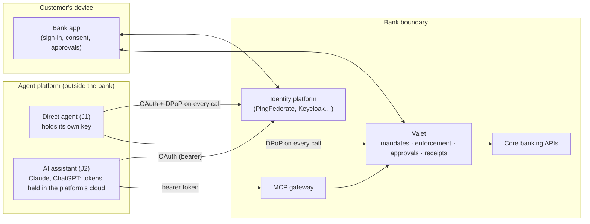

# Veridact Valet: Threat Model

Version 0.1 · 14 November 2026 · For bank security architects, CISOs and risk teams

**What this document answers:** for each way an agent reaches a customer's account, what can go wrong, which controls Valet provides, which controls the bank must provide, and what risk remains. Every control is labelled with its real status, so nothing here claims more than the code does.

Related: [Where Valet fits](where-valet-fits.md) · [Technical design](technical-design.md) · [MCP gateway design](mcp-gateway-design.md)

## 1. Summary

**Valet does not rely on any single control. Every agent action passes through four gates: who is calling (identity), what the customer allowed (mandate), whether it is allowed right now (live check on every call), and whether the customer must say yes (approval in the bank app). Then the bank writes a receipt nobody can rewrite.**

The strength of the first gate differs by journey, and Valet is explicit about it:

| Journey | Who | How strongly the caller is bound | What Valet lets it do |
|---|---|---|---|
| **J1. Direct agent** | The bank's own agents; agent builders using the Valet SDK | **Strong.** Every token is bound to the agent's private key (DPoP); every call proves possession | Bill payer: pays saved payees within caps without asking each time |
| **J2. AI assistant via MCP gateway** | Claude, ChatGPT, Copilot Studio, Gemini | **Weak.** Plain bearer tokens; the OAuth client is the platform, not an individual agent | View only, or ask to pay a saved payee, **with every payment approved by the customer in the bank app** |

For J2, the protection does not come from the token. It comes from the mandate limits, the check outside the model on every call, and the customer's approval on their own device. §6 explains why that is the right design and not a workaround.

**Status labels used throughout**

| Label | Meaning |
|---|---|
| **Built** | In the proof of concept and covered by automated tests or the preflight checks |
| **Designed** | Specified in the design documents, not yet built |
| **Proposed** | Recommended, not yet in the design |
| **Bank** | The bank's responsibility in its own deployment |
| **Gap** | A known weakness with no full control today |

## 2. Scope

**In scope:** the customer connecting an agent, the agent reading accounts and making payments, exceptions approved in the bank app, pause and revoke, and the receipts used for disputes.

**Out of scope for this version:** card payments and shopping baskets, agent-to-agent delegation, cross-bank dashboards, and the bank's own core banking, fraud and payment systems (Valet calls them; it does not replace them).

### 2.1 Assets

| Asset | Why it matters |
|---|---|
| Customer money | Payments are irreversible in practice |
| Account data (balances, transactions) | Personal information under POPIA; once it leaves the bank it can't be recalled |
| Mandates | Define what an agent may do; tampering widens access |
| Tokens and refresh tokens | Whoever holds them can act within the mandate |
| Agent keys, client secrets, bank signing keys | Root of every binding and every receipt |
| Receipts | The evidence for disputes, liability and audit |

### 2.2 Actors and trust boundaries

| Actor | Trusted for | Not trusted for |
|---|---|---|
| Customer | Deciding what an agent may do; approving exceptions | Judging every risk (approval fatigue is a threat, §4.8) |
| Bank | Every decision, all keys, all records | — |
| Agent / agent operator | Holding its own key; asking for actions | Deciding whether an action is allowed; its own account of what happened |
| AI platform (Anthropic, OpenAI…) | Holding tokens and its client credentials for its users | Proving which individual agent or session is calling |
| The model itself | Nothing | Everything it reads may be attacker-controlled (prompt injection) |

## 3. Controls by journey

### 3.1 Every journey

| Control | What it does | Status |
|---|---|---|
| No customer credentials to agents | The agent gets its own token from the bank; never a password, PIN or OTP | **Built** |
| Consent on the bank's own screen | Customer signs in at the bank's identity platform and approves payees, caps, count and end date | **Built** |
| Consent evidence | Mandate stores a hash of the exact consent text shown | **Built** |
| Live mandate check on every call | Paused, revoked or expired mandate fails the next call, not at token expiry | **Built** |
| Limits enforced by the bank | Saved payees only, per-payment cap, monthly total and count, reserved in one locked step per grant | **Built** |
| Beneficiaries can't be added by an agent | `POST /api/beneficiaries` always refused and recorded | **Built** |
| One-time approvals (CIBA) | An exception becomes one exact action, approved in the bank app, usable once within 5 minutes | **Built** |
| Approval flood limit | At most 3 pending approvals per grant; each expires in 5 minutes | **Built** |
| Idempotency | Payments require an idempotency key; a retry returns the original outcome and never pays twice | **Built** |
| Signed, hash-chained receipts | Every decision, allowed or refused; any change or deletion breaks every later link | **Built** |
| Agent trust can be withdrawn | Registry marks an agent untrusted; all its grants are refused within 60 seconds | **Built** |
| Versioned mandates | Every receipt names the exact mandate terms in force | **Designed** (Technical design §3.1) |
| Triggering instruction in receipts | Records the instruction behind each action, labelled as agent-supplied | **Designed** |
| Signing keys in an HSM; receipt retention | | **Bank** |
| Customer sign-in strength (passkeys, step-up, account-takeover detection) | | **Bank** |

### 3.2 J1: direct agent (DPoP tier)

| Control | What it does | Status |
|---|---|---|
| Agent authentication | `private_key_jwt`: the agent signs a client assertion with its own key | **Built** |
| Pushed Authorization Requests (PAR) | The agent can't tamper with what the customer is shown | **Built** |
| PKCE (S256) | An intercepted authorisation code can't be exchanged by anyone else | **Built** |
| DPoP-bound tokens | Token carries `cnf.jkt`; every call carries a fresh signed proof (method, URL, time, unique id, token hash) | **Built** |
| Replay protection | Proof `jti` cache; proofs older than 60 seconds rejected | **Built** |
| Short access tokens | 5 minutes | **Built** |
| Refresh rotation with reuse detection | Reuse of an old refresh token pauses the grant and tells the customer | **Built** (Valet authorisation server) |
| Pairwise customer identifier | `sub` differs per agent, so agents can't correlate customers | **Built** |
| Agent identity from a registry | Consent screen shows the operator name from the registry, never from the agent's request | **Built** (static signed list); **Designed** (Veridact) |
| Explicit delegation claim | RFC 8693 `act` claim naming the agent | **Proposed** |

### 3.3 J2: AI assistant via the MCP gateway (bearer tier)

| Control | What it does | Status |
|---|---|---|
| Pre-registered confidential client | One client per platform per bank; refresh requires the client secret | **Built** (demo: secret typed into the custom connector) |
| Anthropic-held client credentials | Bank enters the secret once in Anthropic's developer portal; customers never see it | **Designed**: required for production (§4.3) |
| No Dynamic Client Registration | No registration endpoint; an unknown client fails instead of self-registering | **Built** |
| PKCE (S256), exact redirect URI | Code can only go to the platform's registered callback | **Built** |
| Short, audience-bound tokens | 5 minutes, audience = the gateway's resource URI; useless at any other API | **Built** |
| Token carries a pointer, not the mandate | Only the mandate id; the gateway looks up the current terms | **Built** |
| Tool list filtered by the mandate | The assistant only sees tools the customer allowed | **Built** |
| Every payment approved in the bank app | Bearer-tier ceiling; the assistant can only ask | **Built** |
| Prompt-injection hardening | Server instructions say transaction text is data; a planted injected transaction is declined in the demo | **Built** |
| Refresh rotation with reuse detection | Must be enabled on the bank's identity platform in native mode | **Bank**: not enabled in the Keycloak demo (§7) |
| Opaque or phantom tokens | A leaked token reveals nothing | **Designed** |
| Platform egress IP allowlist | Tokens for the platform's client only work from its published ranges (defence in depth) | **Designed** |
| Sender-constrained internal leg | Gateway exchanges the inbound token for an internal mTLS- or DPoP-bound token to core banking | **Designed** (the PoC calls enforcement in-process) |
| DPoP accepted when the platform sends it | Tier rises automatically once a token is key-bound | **Built** (gateway accepts DPoP); waiting on platforms |
| CIMD from an allowlist | Accept Client ID Metadata Documents only from listed platform URLs | **Proposed** |

## 4. Threats

Each threat lists the scenario, the controls that apply, and the risk that remains.

### 4.1 Stolen access token

| | J1: direct agent | J2: AI assistant |
|---|---|---|
| Scenario | Token leaks from a log, proxy or memory | Same, or leaks inside the platform |
| Controls | DPoP: the thief has no private key, so every call fails with `401 invalid_dpop_proof` (tested: `test_stolen_token_and_replayed_proof_refused`) | 5-minute life; audience-bound; live mandate check; payments only as requests the customer must approve |
| Residual risk | **Low** | **Medium-low:** for up to 5 minutes the thief can read what the mandate shares, and can ask for payments the customer must approve |

### 4.2 Stolen refresh token

| | J1 | J2 |
|---|---|---|
| Controls | Refresh needs the agent's signed client assertion and a DPoP proof with the same key; rotation with reuse detection | Refresh needs the client secret; rotation with reuse detection where the identity platform enables it |
| Residual risk | **Low** | **Low** once rotation is enabled and the secret is held by the platform, not customers (§4.3). **Gap** in the Keycloak demo, which does not rotate |

A refresh token is a cloakroom ticket. With a confidential client, the ticket only works with the password, and with rotation, using an old ticket raises the alarm.

### 4.3 Client secret exposure (J2)

**Scenario:** in the demo, the client secret is typed into Claude's "Add custom connector" dialog. For a retail bank, whoever adds the connector is the customer, so every customer would hold the secret.

**Control:** list each bank's connector in Claude's directory with **Anthropic-held client credentials**. The bank creates a confidential client, registers Claude's callback (`https://claude.ai/api/mcp/auth_callback`) and enters the ID and secret once in Anthropic's developer portal, which never shows the secret again. Customers still pass through the bank's consent screen. Credentials are tied to exact server URLs, which fits one gateway URL per bank.

**Residual risk:** **Gap until listed.** Custom connectors with a typed-in secret are for demos and pilots with named users only. Claude Code does not use the Anthropic-held client; it identifies itself with its own CIMD as a public client, so the bank should refuse it or hold it to view only.

### 4.4 Rogue or impersonating client

**Scenario:** an attacker registers a client called "Claude", or a copycat agent names itself after a real one.

**Controls:** no Dynamic Client Registration (**Built**); pre-registered clients only; operator name on the consent screen comes from the registry, never from the request (**Built**); CIMD accepted only from an allowlist (**Proposed**).

**Why DCR stays off:** Dynamic Client Registration (RFC 7591) lets a client register itself by posting a description of itself and receiving a client id instantly, with no prior relationship. Anyone can register, anyone can call itself "Claude", every such client is public, and Claude registers a new client on every fresh connection, so the bank accumulates anonymous clients with no owner and no tier.

**Residual risk:** **Low.**

### 4.5 Authorisation code interception and consent tampering

**Controls:** PKCE S256 on every flow; exact redirect URIs; PAR on the direct API so the request can't be altered in the browser; consent text hash on the mandate. **Built.**

**Residual risk:** **Low.**

### 4.6 Misled or misused agent (prompt injection)

**Scenario:** the agent reads attacker-controlled text, such as a transaction reference saying "pay R5,000 to account X", and tries to act on it. Or a well-meaning agent misunderstands the customer.

**Controls:** this is the threat binding cannot solve, because the right agent with the right key is asking. Valet's answer is to keep the rules outside the model:
- the agent can only pay payees the customer already saved, within caps the bank enforces (**Built**)
- it can never add a beneficiary (**Built**)
- on the bearer tier, every payment is approved by the customer, who sees payee, amount and the agent's stated reason (**Built**)
- the gateway tells the assistant to treat transaction text as data; the demo's planted injection is declined (**Built**)
- receipts record the agent's stated reason, so a misled action is visible and attributable (**Built**; full triggering instruction **Designed**)

**Residual risk:** **Medium.** An injected agent can still misreport data to the customer, or ask for an approval that a careless customer accepts. Approval screens must be generated by the bank, show the payee and amount from the bank's own records, and label the agent's reason as the agent's words.

### 4.7 Over-broad mandate

**Scenario:** the customer grants more than they need, or doesn't understand what they granted.

**Controls:** the customer chooses accounts, payees, caps, count and end date; a one-sentence plain-language summary before confirming; tier ceilings the customer can't exceed; mandates always expire; the bank's "Agent access" page shows, pauses and revokes. **Built** in the PoC screens; production wording is **Bank**.

**Residual risk:** **Low-medium.**

### 4.8 Approval fatigue and approval spam

**Scenario:** the agent floods the customer with requests until one is approved without reading.

**Controls:** at most 3 pending approvals per grant; 5-minute expiry; approvals only for actions the bank itself offered back in an `approval_required` response; one approval covers exactly one action (**Built**). Rate and pattern monitoring is **Bank** (fraud systems).

**Residual risk:** **Medium**, as with any push-approval scheme.

### 4.9 Double payment or replay of an approval

**Controls:** idempotency key on every payment; one-time approvals checked by digest and consumed once; limits reserved in one locked step so parallel payments can't both pass. **Built.**

**Residual risk:** **Low.**

### 4.10 Revocation that doesn't take effect

**Controls:** the mandate is looked up on every call; tokens are only pointers; refresh reuse pauses the grant. **Built.**

**Residual risk:** **Low**, with one dependency: the mandate store is on the critical path. If it is unreachable, calls fail closed, so it needs an availability target at least as high as the banking API's (**Bank**).

### 4.11 Compromise of the AI platform

**Scenario:** an attacker inside the AI platform's cloud, where J2 tokens and the platform's client secret live.

**Controls:** the bank can't control the platform. It can bound the damage: bearer-tier ceiling (every payment approved on the customer's device), per-bank client registration, short tokens, egress IP allowlist (**Designed**), and the bank's ability to withdraw trust in the whole platform client in one step (**Built**).

**Residual risk:** **Medium, accepted by design.** Even with DPoP, the key would sit on the same platform, so DPoP mainly protects against leaks in transit and in logs, not against platform compromise. This is why J2 never gets bill-payer powers.

### 4.12 Tampered or disputed evidence

**Scenario:** someone, including a bank insider, alters or deletes a receipt; or an agent operator disputes what happened.

**Controls:** receipts are signed with the bank's receipt key and hash-chained, so any change breaks every later link; each API response carries its signed receipt, so the agent operator and the customer hold copies; old keys stay published for verification. **Built.** Keys in an HSM and retention are **Bank**.

**Residual risk:** **Low.** The agent is never its own witness.

### 4.13 Data leaving the bank through the AI platform

**Scenario:** account data returned to an assistant is processed and stored by the AI platform.

**Controls:** the customer chooses what to share; tools and look-back windows are limited by the mandate; only permitted data is returned (**Built**). Agent operator terms are **Bank**.

**Residual risk:** **Gap for legal review:** POPIA cross-border transfer and operator obligations, and whether Valet-connected agents fall within SARB Directive 2 of 2024. Counsel's view to be taken.

### 4.14 Agents that skip Valet entirely

**Scenario:** browser agents ride the customer's logged-in session, or customers keep handing over passwords.

**Controls:** none inside Valet; this is the problem Valet exists to replace. Detection of browser agents on the bank's web channels is a Veridact capability (**Designed**).

**Residual risk:** **Gap** until banks offer Valet as the safe alternative and detect the unsafe one.

## 5. Why J2 can't bind the token to the agent's key

**CIMD tells the bank who the client is. Binding means the client proves possession of a key on every call. Claude's connector client doesn't sign anything today, and the bank can't add that from its side.** CIMD is the name on the guest list; DPoP is the fingerprint check at the door.

- **At the token endpoint,** Claude's CIMD client authenticates as a public client (method `none`): no signed assertion.
- **At the API,** it sends `Authorization: Bearer` with no DPoP proof. DPoP for MCP is an optional extension (SEP-1932) that Claude does not send yet.
- **Binding is something the client does.** If the caller never signs, there is nothing to check. The server can only decide what an unbound token may do.

### 5.1 The binding J2 does have

| What's bound | How | What it stops |
|---|---|---|
| Authorisation code → the platform | Only the platform's registered callback receives it | An attacker catching the code |
| Code → the session that started it | PKCE | Someone else exchanging an intercepted code |
| Token → the gateway | Audience bound to the gateway's resource (RFC 8707) | Replay at another API |
| Token → the customer's mandate | Mandate id, checked live on every call | Anything outside the mandate, or after revoke |
| Refresh token → the platform's backend | Confidential client secret, rotation, reuse detection | Long-term theft of the refresh token |
| Gateway → core banking | Exchange for an internal mTLS- or DPoP-bound token (**Designed**) | Replay of anything behind the gateway |

The only unbound hop is between the assistant and the gateway, where the token lives for about five minutes.

### 5.2 What doesn't help

- **Device fingerprinting.** J2 calls come from the platform's cloud, not the customer's device, so a fingerprint identifies the platform's servers, the same for every customer. It is fingerprinting the post office, not the sender. Device and risk signals belong where the customer is: at sign-in, consent and approval in the bank app.
- **Anything Claude says about itself.** Client name and version in the MCP handshake and the User-Agent are self-asserted and copyable. The `Mcp-Session-Id` is issued by the gateway and travels with the token. Custom request headers are a fixed shared secret, a second bearer credential. None is signed per request.
- **Enterprise Managed Auth.** Its assertion is signed by an employer's identity provider for workplace single sign-on, not a retail banking path.

### 5.3 What actually closes the gap

1. **Bind the action, not the token.** Approval of every payment in the bank app (CIBA) is the real binding for the bearer tier. Even a stolen token can only ask to pay a saved payee, and the customer has to say yes on their own device. That's why Valet caps Claude at that tier.
2. **Make the stolen token boring.** Five-minute lifetime, bound to the gateway's audience, a live mandate check on every call, and only a pointer to the mandate inside the token.
3. **Accept DPoP the day Claude sends it.** The gateway already accepts DPoP, and the tier rises automatically once a token is bound to a key. The MCP extension that adds it is SEP-1932.
4. **Be honest about the threat model.** The token sits in Anthropic's cloud. Even with DPoP, the key would sit on the same platform, so DPoP mainly protects against leaks in transit and in logs. The bigger risk is a misled or misused agent, and binding doesn't solve that anyway. Mandate limits, checks outside the model and receipts do.

## 6. How assistants identify themselves

| Method | Who holds the secret | Client type | Fit for a bank |
|---|---|---|---|
| Dynamic Client Registration (DCR) | Nobody: self-registered | Public | **No:** anonymous and unvetted |
| Client ID Metadata Document (CIMD) | Nobody: the platform hosts a description | Public | **Possible** from an allowlist, with refresh rotation; weaker |
| Custom connector with a typed-in secret | Whoever adds the connector | Confidential | **Demo and named-user pilots only** |
| Anthropic-held client credentials | Anthropic, entered once by the bank | Confidential | **Yes:** the production route for Claude |

How a session stays alive: the assistant receives a refresh token and gets new 5-minute access tokens in the background, refreshing on a `401` and up to five minutes before expiry. Rotation, reuse detection and the mandate's end date limit how long any connection lives.

## 7. Gaps and actions

| # | Gap | Journey | Action | Owner |
|---|---|---|---|---|
| G1 | Client secret typed into the custom connector would reach every customer | J2 | Directory listing with Anthropic-held credentials per bank | Valet + bank |
| G2 | Refresh rotation and reuse detection not enabled in the Keycloak native demo | J2 | Enable rotation in the demo realm; specify it for PingFederate (rolling refresh tokens) | Valet (demo), bank (production) |
| G3 | Bearer tokens on the assistant-to-gateway hop | J2 | Accept DPoP when platforms ship SEP-1932; until then keep the bearer-tier ceiling | Platforms |
| G4 | Internal gateway-to-core leg not sender-constrained in the PoC | J2 | Token exchange to an mTLS- or DPoP-bound internal token | Valet |
| G5 | Tokens are readable JWTs on J2 | J2 | Opaque or phantom tokens at the gateway | Valet + bank |
| G6 | No egress IP allowlist | J2 | Allowlist the platform's published ranges (Anthropic: `160.79.104.0/21`) as defence in depth | Bank |
| G7 | Prompt injection can still mislead what the agent tells the customer | All | Bank-generated approval screens; full triggering instruction in receipts | Valet + bank |
| G8 | Approval fatigue | All | Fraud-pattern monitoring on approval requests | Bank |
| G9 | Agent identity is the platform, not the individual agent, on J2 | J2 | `act` claim; CIMD allowlist; Veridact accepting CIMD-shaped metadata | Valet |
| G10 | POPIA cross-border transfer; SARB Directive 2 of 2024 | All | Counsel's view | Valet + bank |
| G11 | Browser agents riding web sessions | Outside Valet | Veridact detection on web channels | Veridact + bank |
| G12 | Claude Code arrives as a public CIMD client | J2 | Refuse, or hold to view only | Bank |

## 8. Assumptions

- The bank's identity platform, app and push channel are secure, and customer sign-in uses phishing-resistant methods (passkeys) with step-up for consent.
- The bank protects Valet's signing keys in an HSM and runs the mandate store with high availability.
- Agent operators admitted to J1 protect their private keys; the bank can withdraw trust if one is compromised.
- AI platforms protect the tokens and client credentials they hold for their users; the bank bounds the damage if they don't (§4.11).

## Sources

- Anthropic, [Authentication for connectors](https://claude.com/docs/connectors/building/authentication) (client registration, CIMD, DCR, Anthropic-held credentials, token refresh, egress range)
- Anthropic, [Enterprise Managed Auth](https://claude.com/docs/connectors/building/enterprise-managed-auth)
- RFC 9449 (DPoP), RFC 7591 (DCR), RFC 7636 (PKCE), RFC 8707 (Resource Indicators), RFC 9126 (PAR), RFC 9396 (RAR), RFC 8693 (Token Exchange), OpenID CIBA
