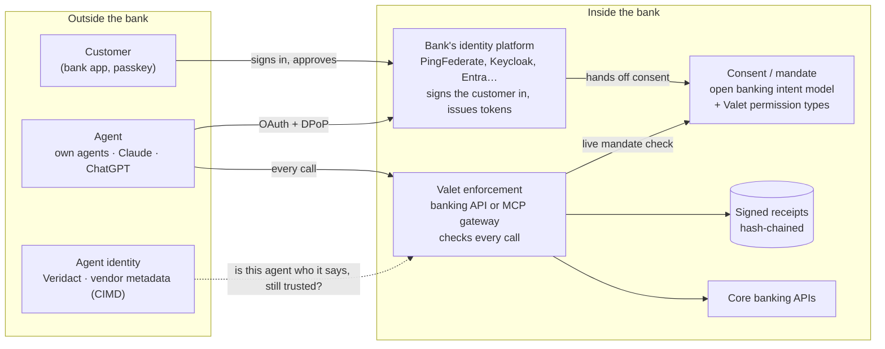
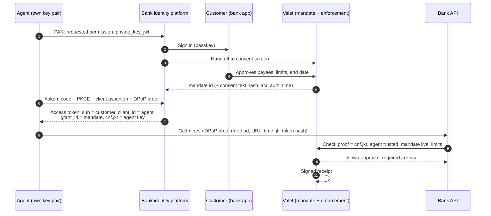

# Veridact Valet: what it is, where it fits, and the questions banks ask

Version 0.1 · 14 November 2026 · For bank architects, security teams and executives

This page answers the three questions bank architecture reviews ask first:

1. *We already have open banking. What does Valet add?*
2. *Why Valet, and not our identity vendor's agent product?*
3. *How exactly is the agent bound to the customer, the token and the mandate?*

The detail behind each answer is in the [Technical design](technical-design.md) and the [MCP gateway design](mcp-gateway-design.md).

## 1. What Valet is

**Valet lets a customer give an AI agent a written, limited, revocable permission to their bank account, checked by the bank on every call and recorded in a receipt nobody can rewrite.**

Think of a valet key. It starts the car but won't open the boot, and the car keeps a logbook. Open banking gave approved companies a key to the account. Valet is the valet key for software that acts on its own.

Valet is an open-source (Apache 2.0) profile of OAuth standards, with reference code, an agent SDK and tests. **The bank runs it, inside its own boundary, on the identity platform it already has.** Nothing calls home, Valet holds no keys, and no customer data leaves the bank.

## 2. Where it fits



Each layer answers one question, and Valet only provides the layers a bank doesn't already have:

| Layer | The question it answers | Who provides it |
|---|---|---|
| Customer identity | Is this really the customer? | **The bank's identity platform**, unchanged: its sign-in, passkeys, step-up and app |
| Agent identity | Which agent is this, who operates it, and is it still trusted? | Veridact (production) or a signed list (PoC), behind one interface; the bank decides who is admitted |
| Consent | What did the customer agree to? | **The bank's open banking consent model**, extended with Valet's permission types |
| Token binding | Is the caller the same agent the permission was granted to? | DPoP (RFC 9449), issued by the bank's platform or Valet's authorisation server |
| Enforcement | May this action happen, right now, within the limits? | **Valet**, at the bank's API or MCP gateway, on every call |
| Evidence | What happened, and can the customer, the bank and the agent operator agree on it? | **Valet** signed, hash-chained receipts, kept by the bank |
| Merchant and card-network intent | What did the customer authorise a shopping agent to buy? | AP2 and Verifiable Intent (FIDO Alliance); complementary, see §6 |

## 3. "We already have open banking. What does Valet add?"

**Open banking answers *which accredited company may access this account*. Valet answers *which agent, acting on which instruction, may do what right now, and can the bank prove it afterwards*.**

Open banking was designed for regulated third parties: a known business, a fixed app, a contract with the bank, and a person who clicked the button. AI agents break those assumptions:

- **The caller is not an accredited third party.** Most agents customers use are run by consumer AI platforms, not registered providers.
- **The software decides what to do next.** An agent can be steered by text it reads, for example a planted instruction in a transaction description.
- **The customer is often not there.** "Pay my bills each month" runs while they are asleep.
- **Disputes need evidence per action**, not just evidence that consent was once given.

Valet is **not a second consent system**. It builds on the open banking intent-based pattern the bank already runs (the [Consent Service](consent-service-openapi.yaml) follows it, generalised with RFC 9396 `authorization_details`). What Valet adds on top:

| Open banking consent gives you | Valet adds |
|---|---|
| Account and payment-initiation permissions per third party | Agent-specific limits: named payees, a cap per payment, a monthly total and count, an approval level, an end date |
| A consent checked when the token is issued | A check on **every call**, outside the model, against the mandate's current state; pause and revoke work on the next call |
| The third party's identity | The **agent's** identity, separate from the platform it runs on, with trust that can be withdrawn |
| Consent records | A **signed receipt for every decision**, allowed or refused, naming the mandate version, the agent, the triggering instruction and any customer approval |
| Exceptions handled by each third party | One-time approvals in the bank's own app (CIBA) for exactly one action |

## 4. "Why Valet, and not our identity vendor's agent product?"

**Valet doesn't replace the identity platform. It runs on it.** In a bank on PingFederate, PingFederate stays the authorisation server and signs every customer in. Valet supplies what the platform leaves to each bank: the banking permission vocabulary, the check on every call, and the evidence.

Identity vendors, Ping Identity included, are adding agent features: detecting agents, agent lifecycle, runtime authorisation, approvals on a trusted device. Those are welcome and Valet uses them where they exist. When evaluating any vendor's agent offering, ask four questions:

1. **Does it define what "pay my bills, up to R2,000 a month, to these payees" means**, in a form every agent can use at every bank? Or does each bank design that itself?
2. **Is every action checked at the bank's own API**, with a live mandate lookup, or only when the token is issued?
3. **Who holds the evidence?** Is there a tamper-evident record per action, inside the bank's boundary, that a customer, the bank and the agent operator can each verify?
4. **Can you leave?** Is the mandate model and its data portable to another identity platform?

Why open source matters here, in order of importance to a bank:

- **You own it.** Mandates, receipts and keys stay in your environment, under your POPIA obligations. No per-agent or per-transaction licence.
- **Your security team can read it.** The rules that decide whether money moves are inspectable and testable, not a black box.
- **It is portable.** The same profile runs on PingFederate, Keycloak, Entra ID, Okta, Auth0 or Curity.
- **You are not depending on one small supplier.** Apache 2.0 gives the right to fork; conformance tests let you prove any implementation, including your own; commercial support, integration and certification are available from Veridact separately; and the banking constraints profile is intended for a standards body, so it outlives any one company.

## 5. "How is the agent bound to the customer, the token and the mandate?"

**The customer authorises a mandate at the bank, the bank pins that mandate to the agent's key, and every call must prove the agent holds that key.** A stolen token is a boarding pass with someone else's photo on it.



The four links in the chain:

1. **Agent to key.** The agent has its own ES256 key pair and authenticates with `private_key_jwt`. The agent registry says who operates it and whether it is still trusted. It never sees a password, PIN or OTP.
2. **Customer to mandate.** The customer signs in at the bank's identity platform and approves the mandate on the bank's own screen. The bank stores the mandate with a hash of the exact text shown and the sign-in evidence.
3. **Mandate and key to token.** At `/token` the agent proves possession of its key with a DPoP proof. The bank writes the key's thumbprint onto the mandate and into the token as `cnf.jkt`.
4. **Every call to proof.** Each request carries a fresh proof signed with the same key. The bank checks it before anything else ([Technical design](technical-design.md) §5), then checks the agent's trust, the mandate's live status and the limits. Exceptions go to the customer's bank app and return a one-time token bound to the same key.

A decoded access token:

```json
{
  "iss": "https://login.bank.example/",
  "aud": "https://api.bank.example/",
  "sub": "pairwise-7f3c…",
  "client_id": "kaya-agent",
  "grant_id": "g_8f2…",
  "cnf": { "jkt": "<thumbprint of the agent's public key>" },
  "authorization_details": [{
    "type": "valet_payments",
    "actions": ["pay_existing_beneficiary"],
    "accounts": ["acc_123"],
    "payees": ["ben_water", "ben_city_power"],
    "approval": "approved_payer",
    "limits": {
      "per_payment": { "amount": "1000.00", "currency": "ZAR" },
      "per_month": { "amount": "2000.00", "currency": "ZAR", "count": 4 }
    }
  }],
  "exp": 1794657600
}
```

`sub` is the customer (pairwise, different per agent), `client_id` is the agent, `grant_id` points to the mandate, and `cnf.jkt` ties all three to one key. **Proposed:** add an RFC 8693 actor claim, `"act": { "sub": "<agent identity>" }`, so "the agent acting for the customer" is explicit in the form identity platforms already use for delegation.

**Try to steal it.** Replay this token from another machine without the agent's private key and the bank answers `401 invalid_dpop_proof`. The PoC proves this in `tests/test_valet.py::test_stolen_token_and_replayed_proof_refused`.

### Assurance tiers: consumer AI assistants

Not every agent can do all four links today. Claude and ChatGPT connect through an OAuth client run by the platform, and send plain bearer tokens without DPoP. To the bank, that caller is the platform, not an individual agent. Valet does not hide this; it sets what each tier may do:

| Tier | Who | What the mandate may allow |
|---|---|---|
| Bearer, platform client | Claude, ChatGPT, Copilot Studio, Gemini today | View only, or Approved payer: **every payment approved in the bank app** |
| DPoP-bound | The bank's own agents; platforms once they send DPoP | Bill payer, within lower caps the bank sets |
| DPoP-bound and Veridact-verified | Agents with a verified Veridact identity | Bill payer, with the bank's full caps |

The stronger the agent proves itself, the more it may do. The bearer tier does not meet FAPI 2.0, and Valet says so; its protections are short-lived, audience-bound tokens, a confidential client per platform, refresh rotation, and customer approval of every payment ([MCP gateway design](mcp-gateway-design.md), *Token protection without client DPoP*).

### Agent identity as a URL the vendor hosts

Agent ecosystems are converging on one pattern: an agent identifies itself with an HTTPS URL that serves its metadata and signing keys. The Personal Agent Protocol (Poppy) does this, and Claude does it through Client ID Metadata Documents (CIMD), hosted by Anthropic. Veridact's `did:web` identities are the same pattern.

What CIMD proves, and what it doesn't:

- **It proves** the client ID is the platform's URL and the authorisation code can only be delivered to the platform's registered callback.
- **It doesn't prove** who is collecting the token. Claude's CIMD client authenticates as a public client (PKCE only), and it identifies the platform, not the individual agent or session.

Valet's position:

- **Never open Dynamic Client Registration.** It creates anonymous clients the bank can't reason about.
- **Allowlist agent identities, each with a tier.** Accept CIMD from an allowlist of platform URLs where a platform offers it; use a pre-registered confidential client where the platform allows a secret, because that adds client authentication at the token endpoint.
- **Use one identity URL for both jobs.** Veridact is designed to accept CIMD-shaped metadata, so the same agent URL serves OAuth client identification and Veridact verification. *(Proposed; see §8.)*

## 6. How Valet lines up with agent payment standards

Google's Agent Payments Protocol (AP2) and Mastercard's Verifiable Intent were contributed to the FIDO Alliance in May 2026. The Personal Agent Protocol is an open standard co-developed by Sierra and Meta. These are complementary layers, and Valet sits at the bank, where they say intent should be checked at issuer authorisation.

| Standard concept | Valet equivalent |
|---|---|
| AP2 *open* mandate: goals, budget and allowed instruments, before a basket exists | Standing mandate (`valet_payments`): payees, caps, count, end date |
| AP2 *closed* mandate: a specific amount for a finalised checkout | One-time approval (`valet_payment_once`), approved in the bank app |
| Verifiable Intent: user bound to a device key | Customer signs in with the bank's passkey before approving the mandate |
| Approval on the person's own device, over a separate channel | CIBA approval in the bank's app |
| Tamper-evident record of what was approved | Signed, hash-chained receipts per decision |
| Agent identity and binding to the user's authority | **Not specified by AP2 or Verifiable Intent.** Valet: agent key, DPoP, mandate pinned to `cnf.jkt` |

## 7. What Valet holds to

1. **Never collect passwords.** An agent gets its own key, issued by the bank.
2. **Write the authority down first.** The customer sees payees, amounts, frequency and end date before the agent acts.
3. **Keep the rules outside the model.** The bank checks every action on every call.
4. **The agent is never its own witness.** The bank keeps signed, tamper-evident receipts.
5. **The bank stays in charge.** Valet is open infrastructure each bank runs itself.

## 8. Honest status

| Item | Status |
|---|---|
| Direct agent API: PAR, RAR, `private_key_jwt`, DPoP, CIBA, per-call checks, receipts | **Built** in the PoC and tested |
| Native mode on Keycloak (Valet consent screen mid-login, grant id in the platform's tokens) | **Built** (`extensions/keycloak-valet`) |
| Consent Service (open banking intent model) | **Built**; OpenAPI in `docs/` |
| MCP gateway for Claude, bearer tier | **Built** for the demo; ChatGPT, Copilot and Gemini follow on the same gateway |
| PingFederate native mode | **Designed**; consent hand-off and token-claim hook to be confirmed |
| `act` claim, CIMD allowlist, Veridact accepting CIMD metadata | **Proposed** |
| Versioned mandates, intent and triggering instruction on every receipt | **Proposed** ([Technical design](technical-design.md) §3.1) |
| Regulatory view (SARB Directive 2 of 2024) | Counsel's view to be taken |

Valet is a proof of concept, not production software. The PoC's fictional bank, agent and customer exist to show the design working end to end.

## Sources

- FIDO Alliance, [Building the trust layer for agentic payments with AP2 and Verifiable Intent](https://fidoalliance.org/building-the-trust-layer-for-agentic-payments-with-ap2-and-verifiable-intent/), May 2026
- Ping Identity, [Personal Agent Protocol: Ping Identity as design partner](https://www.pingidentity.com/en-us/docs/blogs/personal-agent-protocol-ping-identity-design-partner)
- Alpic, [Poppy: what the Personal Agent Protocol is and how to ship it](https://alpic.ai/blog/poppy-what-the-personal-agent-protocol-is-and-how-to-ship-it)
- Anthropic, [Authentication for connectors](https://claude.com/docs/connectors/building/authentication) and [Add a custom connector](https://claude.com/docs/connectors/custom)
- RFC 9449 (DPoP), RFC 9396 (RAR), RFC 9126 (PAR), RFC 8693 (Token Exchange), OpenID CIBA
